# web-server

C와 POSIX 소켓 API로 직접 만든 **웹 서버**와 **프록시**입니다. 웹 서버는 정적 파일과 CGI 결과를 HTTP로 돌려주고, 프록시는 여러 대의 웹 서버 앞에서 요청을 나눠 보냅니다. 버튼을 누르면 실제 요청을 보내고 각 프로세스가 무엇을 했는지 보여 주는 데모 페이지 [Web Server Lab](#web-server-lab-데모-페이지)도 들어 있습니다.

## 팀

<table align="center">
  <tr>
    <td align="center" width="50%">
      <a href="https://github.com/ksomang"></a><br><br>
      <a href="https://github.com/ksomang"><b>김소망</b></a>
    </td>
    <td align="center" width="50%">
      <a href="https://github.com/NARi3040"></a><br><br>
      <a href="https://github.com/NARi3040"><b>박준호</b></a>
    </td>
  </tr>
</table>

## 목차

1. [웹 서버 한 대를 띄우면 끝일까?](#1-웹-서버-한-대를-띄우면-끝일까)
2. [실행 화면](#2-실행-화면)
3. [직접 실행](#3-직접-실행)
4. [아직 없는 것](#4-아직-없는-것)

## 1. 웹 서버 한 대를 띄우면 끝일까?

웹 서버의 기본은 단순합니다. 연결을 받고(`accept`), 요청을 읽고, 파일을 찾아 보내면 됩니다. 사용자가 한 명이면 이것으로 충분합니다. **그런데 요청이 여러 개가 되고 서버가 여러 대가 되면 무슨 일이 생길까요?**

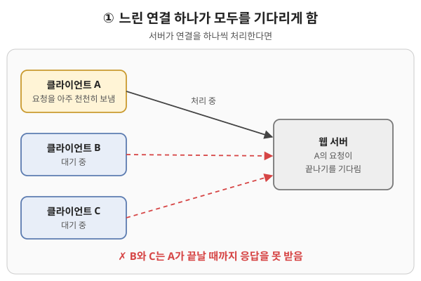

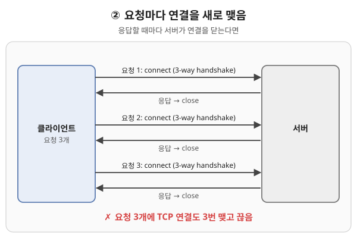

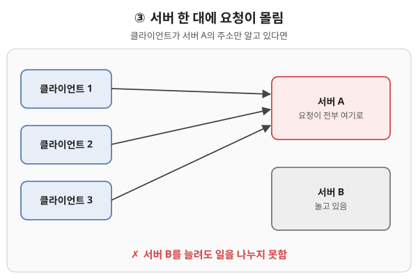

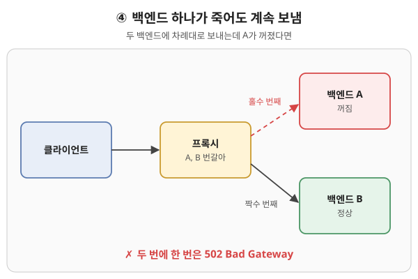

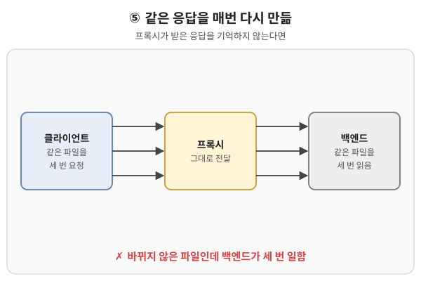

다섯 장면을 이렇게 풀었습니다.

| 장면 | 해결 방법 | 자세히 |
| --- | --- | --- |
| ① 느린 연결이 모두를 막음 | 웹 서버는 연결마다 `fork`로 자식 프로세스를, 프록시는 연결마다 스레드를 만듭니다 | [단계 9·10](docs/step9-10.md), [단계 14](docs/step14.md) |
| ② 매번 새 연결 | keep-alive로 연결 하나에서 요청 여러 개를 처리합니다. 프록시와 백엔드 사이의 연결도 닫지 않고 보관했다가 다시 씁니다 | [단계 15](docs/step15.md), [단계 19](docs/step19.md) |
| ③ 한 대에 몰림 | 클라이언트는 프록시만 알면 됩니다. 프록시가 백엔드를 차례대로 골라 보냅니다(라운드로빈) | [단계 11~13](docs/step11-13.md) |
| ④ 죽은 백엔드 | 헬스 체크로 꺼진 백엔드를 빼고, 연결에 실패하면 바로 다음 백엔드로 다시 보냅니다(failover) | [단계 16](docs/step16.md) |
| ⑤ 같은 응답 반복 | 설정한 경로의 응답을 프록시 메모리에 10초 동안 두고 다시 씁니다 | [단계 17](docs/step17.md), [단계 18](docs/step18.md) |

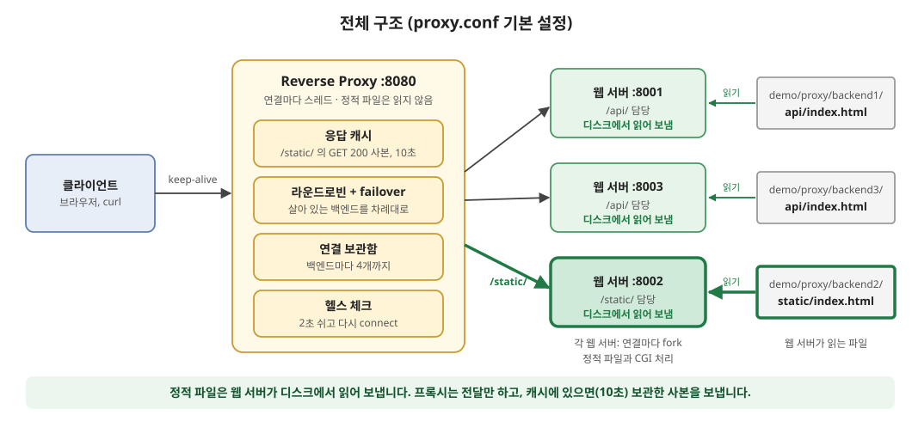

### 웹 서버 (`build/server`)

- `GET`과 `POST`를 받습니다. 그 밖의 메서드는 501입니다.
- 정적 파일은 지정한 폴더(기본 `./www`)에서 읽어 확장자에 맞는 `Content-Type`과 `Content-Length`를 붙여 보냅니다. 경로의 한 칸이 `..`이면(예: `/a/../b`) 403입니다.
- `/cgi-bin/`으로 시작하는 경로는 프로그램을 실행합니다. 요청 정보는 환경 변수로, POST 본문(최대 1MiB)은 파이프를 통해 표준 입력으로 넘기고, 표준 출력을 받아 응답을 만듭니다.
- 다음 요청이 5초 동안 없으면 연결을 닫습니다.
- `Ctrl+C`(`SIGINT`)나 `SIGTERM`을 받으면 새 연결을 받지 않고, 처리 중인 연결이 끝난 뒤 종료합니다.

### 프록시 (`build/proxy`)

- **Reverse Proxy**: [`proxy.conf`](proxy.conf)의 경로 접두사로 백엔드를 고릅니다. 맞는 규칙이 없으면 404, 살아 있는 백엔드가 없으면 503입니다.
- **Forward Proxy**: 요청 대상이 `http://`로 시작하면 클라이언트가 적은 서버로 보냅니다. 연결하지 못하면 502입니다. 설정 파일에 `allow 주소[:포트]` 줄(최대 8개)이 있으면 목록에 있는 서버로만 보내고 나머지는 403입니다. 주소는 적힌 글자 그대로 비교하고, `allow` 줄이 없으면 모든 서버로 보냅니다.
- **헬스 체크**: 모든 백엔드에 `connect`해 보고 2초 쉬기를 반복합니다.
- **캐시**: `cache` 접두사에 맞는 `GET`의 200 응답을 저장합니다. 사본 하나는 100KiB, 전체는 1MiB까지입니다.
- **연결 보관함**: 백엔드마다 쉬는 연결을 4개까지 보관하고, 본문 없는 `GET`에 다시 씁니다.

## 2. 실행 화면

### Web Server Lab (데모 페이지)

[`demo/lab`](demo/lab/README.md)의 발표용 페이지입니다. 버튼을 누르면 CGI 프로그램이 웹 서버나 프록시에 실제 요청을 보내고, 화면에는 주고받은 요청과 응답, 각 프로세스의 로그가 함께 나옵니다. 실행 방법은 [데모 페이지 실행](#데모-페이지-실행)에 있습니다.

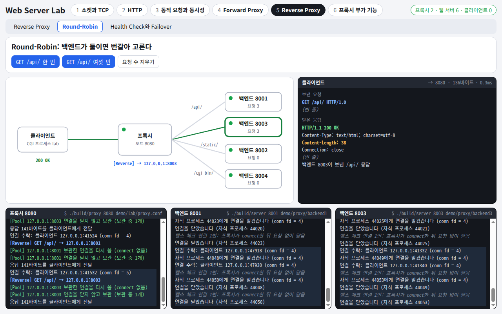

**Round-Robin.** `/api/` 요청 여섯 번이 8001과 8003에 세 번씩 갔습니다. 프록시 로그에서는 보관한 연결을 다시 쓴 것도 보입니다.

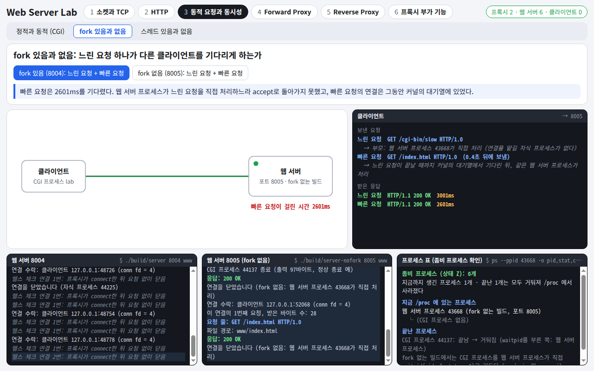

**fork 있음과 없음.** `fork`를 뺀 비교용 빌드에서는 느린 요청이 끝날 때까지 다음 연결을 받지 못해, 빠른 요청이 2601ms 걸렸습니다.

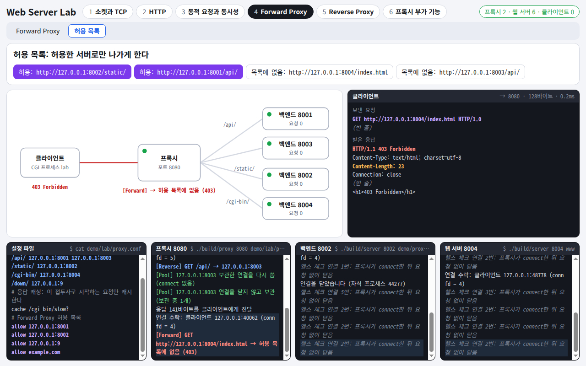

**Forward Proxy 허용 목록.** 목록에 없는 서버로 보내 달라는 요청에는 연결하지 않고 403을 돌려줍니다.

| 주제 | 장면 |
| --- | --- |
| 소켓과 TCP | Socket과 fd, TCP Handshake와 레이어 |
| HTTP | HTTP GET, 상태 코드, POST, HTTP/1.0과 HTTP/1.1 |
| 동적 요청과 동시성 | 정적과 동적(CGI), fork 있음과 없음, 스레드 있음과 없음 |
| Forward Proxy | Forward Proxy, 허용 목록 |
| Reverse Proxy | Reverse Proxy, Round-Robin, Health Check와 Failover |
| 프록시 부가 기능 | keep-alive, Response Caching |

### 브라우저로 연 웹 서버

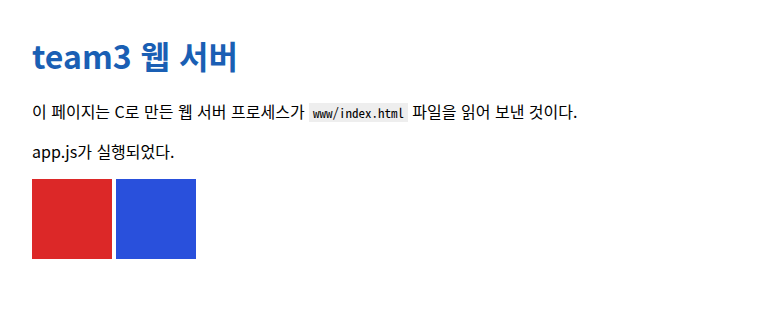

웹 서버를 띄우고 브라우저로 연 화면입니다. HTML, CSS, JavaScript, PNG, JPG 파일을 각각 알맞은 `Content-Type`으로 보내야 이렇게 보입니다.

### 프록시 터미널 출력

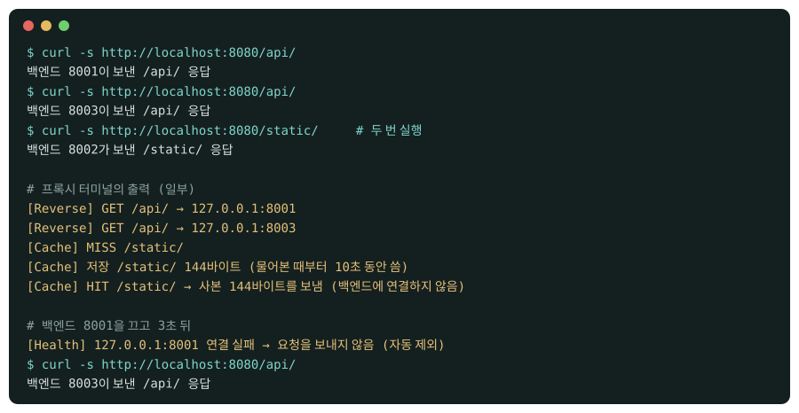

프록시에 요청을 보낸 실제 출력입니다. `/api/`는 8001과 8003이 번갈아 응답하고, `/static/`은 두 번째부터 캐시에서 나가며, 8001을 끄면 8003만 응답합니다.

## 3. 직접 실행

Linux(또는 WSL)에 `gcc`, `make`, `curl`이 있어야 합니다.

### 1단계: 코드 받고 빌드하기

```bash
git clone https://github.com/team3-web-server/web-server.git
cd web-server
make
```

`build/server`, `build/proxy`, CGI 예제 프로그램(`www/cgi-bin/hello`, `www/cgi-bin/echo`)이 만들어집니다. 이후 명령은 모두 `web-server` 폴더에서 입력합니다.

### 2단계: 웹 서버 띄우기

```bash
./build/server
```

8080번 포트에서 `./www` 폴더를 보여 줍니다. 포트와 폴더는 `./build/server 9000 ./www`처럼 바꿀 수 있습니다. 브라우저에서 `http://localhost:8080/`을 열면 [브라우저로 연 웹 서버](#브라우저로-연-웹-서버) 화면이 나옵니다.

### 3단계: 새 터미널에서 요청 보내기

```bash
curl -i http://localhost:8080/
```

`index.html`을 응답 헤더까지 보여 줍니다.

```bash
curl -i 'http://localhost:8080/cgi-bin/hello?name=kim'
```

CGI 프로그램이 `QUERY_STRING=name=kim`과 자기 프로세스 번호, 시각을 돌려줍니다.

```bash
curl -X POST --data-binary 'hello' http://localhost:8080/cgi-bin/echo
```

보낸 본문 `hello`와 길이 `CONTENT_LENGTH=5`를 돌려줍니다.

```bash
curl -i http://localhost:8080/nope.html
```

`404 Not Found`가 돌아옵니다. 확인이 끝나면 서버 터미널에서 `Ctrl+C`를 눌러 끕니다. 다음 단계의 프록시가 같은 8080 포트를 씁니다.

### 4단계: 백엔드 세 대와 프록시 띄우기

터미널 네 개에 하나씩 실행합니다.

```bash
./build/server 8001 demo/proxy/backend1    # 터미널 1: /api/
./build/server 8002 demo/proxy/backend2    # 터미널 2: /static/
./build/server 8003 demo/proxy/backend3    # 터미널 3: /api/
./build/proxy 8080 proxy.conf              # 터미널 4: 프록시
```

### 5단계: 프록시에 요청 보내기

다섯 번째 터미널에서 입력합니다. 어느 백엔드로 갔는지, 캐시를 썼는지는 프록시 터미널에도 출력됩니다.

```bash
curl http://localhost:8080/api/       # 두 번 실행: 8001, 8003이 번갈아 응답
curl http://localhost:8080/static/    # 두 번 실행: 두 번째는 [Cache] HIT
curl -i http://localhost:8080/other   # 404 (맞는 규칙 없음)
curl -x http://localhost:8080 http://localhost:8002/static/   # Forward Proxy로 보내기
```

이어서 터미널 1의 백엔드를 `Ctrl+C`로 끄고 몇 초 뒤 `/api/`를 요청하면 8003만 응답합니다. 터미널 3까지 끄면 `503 Service Unavailable`이 돌아옵니다.

### 6단계: 테스트 실행하기

```bash
make test    # 웹 서버 테스트와 프록시 테스트
make asan    # 같은 테스트를 AddressSanitizer·LeakSanitizer로
```

테스트마다 `PASS` 또는 `FAIL`이 한 줄씩 나옵니다. 테스트는 18000번대 포트를 씁니다.

### 데모 페이지 실행

위 단계에서 띄운 서버와 프록시를 모두 끈 뒤 실행합니다.

```bash
bash demo/lab/run.sh
```

필요한 프로그램을 빌드하고 서버와 프록시를 한 번에 띄웁니다. 브라우저에서 `http://localhost:8000/`을 열고, 끝낼 때는 `Ctrl+C`를 누릅니다. 8000~8005, 8080, 8081 포트가 비어 있어야 합니다.

TCP Handshake와 레이어 장면에는 `tcpdump`와 패킷 캡처 권한이 필요합니다. 한 번만 실행해 두면 되고, 하지 않아도 다른 장면은 동작합니다.

```bash
which tcpdump || sudo apt install -y tcpdump
sudo setcap cap_net_raw,cap_net_admin=eip "$(readlink -f "$(which tcpdump)")"
```

> 로컬 발표용입니다. 서버와 프록시는 모든 IPv4 주소(`0.0.0.0`)에서 연결을 받고, 데모 페이지는 백엔드 프로세스를 끄고 켤 수 있습니다. 다른 사람이 접속할 수 있는 네트워크에서는 띄워 두지 마세요.

## 4. 아직 없는 것

- HTTPS와 `CONNECT` 메서드. Forward Proxy는 `http://`만 됩니다.
- IPv6. IPv4만 됩니다.
- 접속하는 쪽의 제한. 기본 설정 [`proxy.conf`](proxy.conf)에는 `allow` 줄이 없어, 프록시에 접속할 수 있으면 누구나 Forward Proxy로 어느 서버에든 요청을 보낼 수 있습니다.
- 웹 서버의 `HEAD`, `PUT`, `DELETE` 등 `GET`·`POST` 밖의 메서드.
- 동시에 만드는 자식 프로세스 수와 스레드 수의 상한.
- 프록시의 `X-Forwarded-For` 헤더, chunked 응답 처리.
- 같은 응답이 캐시에 없는 순간에 요청이 몰리면 백엔드가 그만큼 일합니다(캐시 스탬피드).

## 더 보기

| 더 보기 | 문서 |
| --- | --- |
| 과제 전체 그림과 로드맵 | [docs/design.md](docs/design.md) |
| 소켓, 요청 줄, 헤더 | [단계 1](docs/step1.md), [단계 2](docs/step2.md), [단계 3](docs/step3.md) |
| 정적 파일, POST 본문, CGI | [단계 4·5](docs/step4-5.md), [단계 6·7](docs/step6-7.md), [단계 8](docs/step8.md) |
| 동시 연결과 안전 종료 | [단계 9·10](docs/step9-10.md) |
| 프록시, 스레드, keep-alive | [단계 11~13](docs/step11-13.md), [단계 14](docs/step14.md), [단계 15](docs/step15.md) |
| 헬스 체크, 캐시, 연결 보관함 | [단계 16](docs/step16.md), [단계 17](docs/step17.md), [단계 18](docs/step18.md), [단계 19](docs/step19.md) |
| 데모 페이지의 장면, 프로세스, 값의 출처 | [demo/lab/README.md](demo/lab/README.md) |
| 대기열·블로킹 시연 도구 | [demo/README.md](demo/README.md) |
