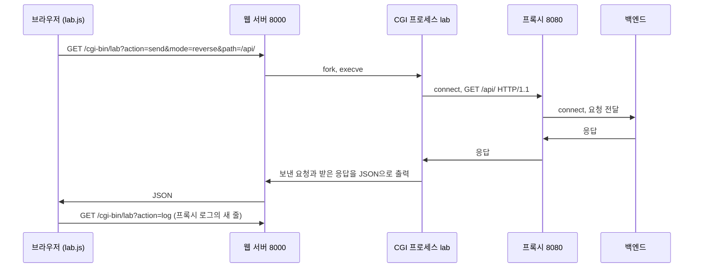

# Web Server Lab (발표용 데모 페이지)

버튼을 누르면 프록시에 실제 요청이 가고, 그 결과와 프록시 로그를 그림으로 보여 주는 페이지다.
지금은 구현된 기능만 장면으로 들어 있다: Reverse Proxy(경로 라우팅), Round-Robin, Forward Proxy, 502 Bad Gateway.

## 실행

WSL 터미널에서 레포 맨 위 폴더에서 실행한다.

```bash
bash demo/lab/run.sh
```

브라우저에서 `http://localhost:8000/` 을 연다. 끝낼 때는 그 터미널에서 Ctrl+C를 누른다. 띄운 프로세스가 모두 끝난다.

## 띄우는 프로세스

| 포트 | 프로세스 | 역할 |
|---|---|---|
| 8000 | `build/server` (폴더 `demo/lab/www`) | 데모 페이지와 CGI 프로그램 `lab`을 서빙한다 |
| 8080 | `build/proxy` | 프록시. 출력은 `demo/lab/run/proxy.log`에 쌓인다 |
| 8001, 8003 | `build/server` | `/api/` 백엔드 |
| 8002 | `build/server` | `/static/` 백엔드 |

## 버튼을 누르면 일어나는 일



- 프록시에 요청을 보내는 클라이언트는 브라우저가 아니라 CGI 프로세스 `lab`이다. 브라우저는 Forward Proxy용 요청 줄(`GET http://... HTTP/1.1`)을 직접 만들 수 없기 때문이다.
- 그림에서 점이 어느 백엔드로 가는지는 프록시 로그의 `[Reverse] GET /api/ → 127.0.0.1:8001` 줄을 읽어서 정한다. 요청이 끝난 뒤에 그 결과를 다시 그리는 것이다.
- 페이지는 프록시를 거치지 않고 8000에서 직접 연다. 프록시가 한 번에 연결 하나만 처리하므로, 프록시를 거쳐 실행된 CGI가 다시 프록시에 요청하면 서로 기다리게 된다.

## 파일

| 파일 | 내용 |
|---|---|
| `demo/lab/run.sh` | 빌드하고 프로세스 다섯 개를 띄운다 |
| `demo/lab/cgi/lab.c` | CGI 프로그램. `action=send`, `status`, `stop`, `start`, `log`, `conf` |
| `demo/lab/www/index.html`, `lab.css`, `lab.js` | 페이지 |

## 주의

- 발표용 로컬 데모다. CGI 프로그램 `lab`은 백엔드 프로세스를 끄고 켤 수 있으므로, 다른 사람이 접속할 수 있는 환경에 띄워 두지 않는다.
- `백엔드 끄기` 버튼은 `demo/lab/run/포트.pid`에 적힌 프로세스에 SIGTERM을 보낸다. `run.sh`로 띄웠을 때만 동작한다.
