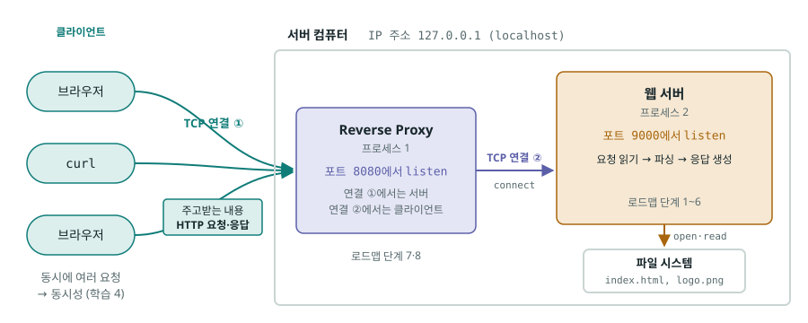
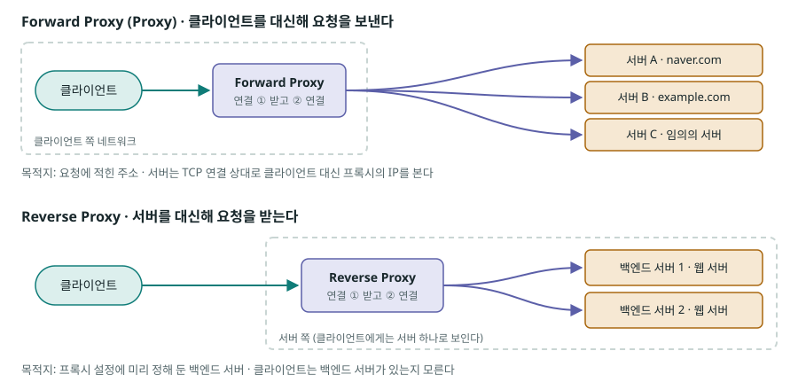
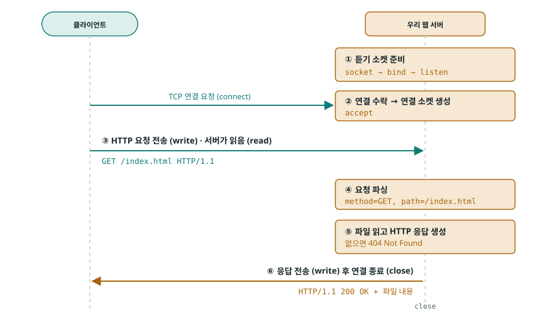
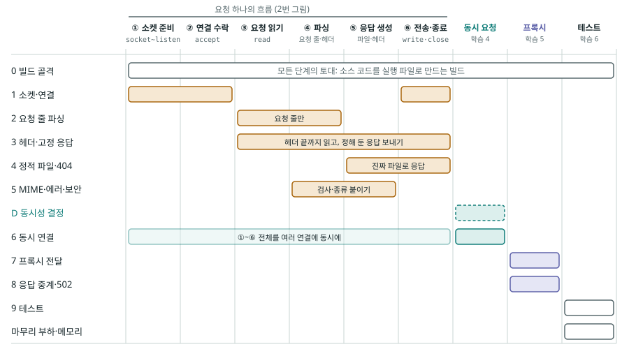

# 웹 서버 과제 큰 그림

## 우리가 만드는 것: 정적 파일 웹 서버와 프록시

클라이언트가 보낸 HTTP 요청을 받아 디스크의 파일을 HTTP 응답으로 돌려주는 **정적 파일 웹 서버**를 POSIX 소켓 API로 C에서 구현하고, 요청을 받아 다른 서버로 전달하는 **프록시(Proxy 또는 Reverse Proxy)**도 구현한다.

## 1. 전체 구성도

| 용어 | 뜻 |
|---|---|
| 클라이언트 | 요청을 보내는 프로그램 (예: 브라우저, `curl`) |
| 서버 | 연결을 기다렸다가 요청에 응답하는 프로그램 |
| IP 주소 | 네트워크에서 컴퓨터를 가리키는 주소. `127.0.0.1`은 자기 자신(localhost) |
| 포트 | 한 컴퓨터 안에서 어느 프로그램으로 갈지 정하는 번호. 0~65535 사이의 16비트 정수 |
| TCP | 연결을 맺은 뒤 바이트를 빠짐없이 순서대로 전달하는 전송 프로토콜 |
| HTTP | TCP 연결 위에서 요청과 응답을 텍스트로 주고받는 형식 규칙 |
| 소켓 | 프로그램이 네트워크 통신에 쓰는 끝점. C에서는 파일 디스크립터(`int`)로 다룬다 |
| 정적 파일 | 디스크에 미리 있는 파일을 내용 그대로 보내는 응답 (예: HTML, 이미지) |
| Reverse Proxy | 클라이언트 요청을 받아 백엔드 서버로 전달하고 응답을 돌려주는 서버 |

## 1-1. Forward Proxy와 Reverse Proxy

| | Proxy (Forward) | Reverse Proxy |
|---|---|---|
| 누구를 대신하나 | 클라이언트 | 서버 |
| 전달할 곳을 정하는 법 | 요청에 적힌 주소 (예: `GET http://example.com/ HTTP/1.1`) | 프록시 설정에 미리 정해 둔 백엔드 서버 |
| 가려지는 쪽 | 서버가 원래 클라이언트의 IP를 직접 보지 못함 | 클라이언트가 백엔드 서버를 직접 보지 못함 |
| 공통 구조 | 연결 ①에서 요청 받기(`accept`) → 연결 ②를 열어 요청 전달(`connect`) → 받은 응답을 연결 ①로 돌려주기 | (왼쪽과 같음) |

## 2. 요청 하나가 처리되는 흐름

### ③ 클라이언트가 보내는 HTTP 요청

| 내용 | 이름 |
|---|---|
| `GET /index.html HTTP/1.1` | 요청 줄 |
| `Host: localhost:8080` | 헤더 |
| (빈 줄) | 헤더 끝 표시 |

### ⑥ 서버가 보내는 HTTP 응답

| 내용 | 이름 |
|---|---|
| `HTTP/1.1 200 OK` | 상태 줄 |
| `Content-Type: text/html` | 헤더: 본문의 MIME 타입 |
| `Content-Length: 27` | 헤더: 본문 바이트 수 |
| (빈 줄) | 헤더 끝 표시 |
| `<h1>Hello</h1> ...` | 본문: 파일 내용 |

## 3. 이 과제가 푸는 질문

| 질문 | 답이 되는 개념 |
|---|---|
| 두 컴퓨터의 프로그램은 어떻게 연결될까? | 소켓, TCP |
| 연결된 뒤 어떤 약속으로 대화할까? | HTTP 요청·응답 |
| 여러 연결이 동시에 들어오면 어떻게 처리할까? | 동시성 모델 |
| 프록시는 받은 요청을 다른 서버로 어떻게 전달할까? | Proxy 또는 Reverse Proxy |
| 정확히 동작하고, 부하를 견디고, 메모리 누수가 없을까? | 단위·기능·부하 테스트, ASan·valgrind |

## 4. 로드맵

| 단계 | 목표 |
|---|---|
| 0 | Makefile·폴더 골격 |
| 1 | 소켓 열고 연결 하나 받아 닫기 |
| 2 | 요청 줄 파싱 |
| 3 | 헤더 읽기 + 고정 응답 |
| - | 토요일 휴식 |
| 4 | 정적 파일 응답 + 404 |
| 5 | MIME, 400·405, `../` 차단 |
| D | 학습 4(동시성) 후 모델 결정 |
| 6 | 동시 연결 처리 |
| 7 | Reverse Proxy 요청 전달 |
| 8 | 응답 중계 + 502 |
| 9 | 기능 테스트 스크립트·단위 테스트 보강 |
| 버퍼 | 밀린 단계 회복 |
| 마무리 | 부하·메모리 검사, 발표 준비 |

| 단계 | 배우는 개념 | 웹 서버의 어느 부분인가 | 끝나면 확인할 수 있는 것 |
|---|---|---|---|
| 0 빌드 골격 | 컴파일, Makefile 규칙, 경고 옵션 `-Wall -Wextra` | 서버 기능은 아니고 개발 환경이에요. `.c` 소스 파일을 컴파일·링크해 실행 파일을 만드는 규칙을 정해요. | `make` 한 번으로 경고 없이 빌드 |
| 1 소켓·연결 | 파일 디스크립터, `socket`·`bind`·`listen`·`accept`·`close`, TCP 연결 | 흐름 ①②⑥. 포트에 듣기 소켓을 열고 TCP 연결을 수락한 뒤 닫아요. 아직 요청 데이터는 읽지 않아요. | `curl`로 접속하면 연결이 받아지고 닫힘 |
| 2 요청 줄 파싱 | HTTP 요청 줄 형식, C 문자열 자르기, 단위 테스트 | 흐름 ③④의 첫 줄. `GET /index.html HTTP/1.1`을 방법, 경로, 버전 세 조각으로 나눠요. | 파서 함수 단위 테스트 통과 |
| 3 헤더·고정 응답 | 헤더 형식(`이름: 값`), 줄 끝 `\r\n`, 빈 줄이 헤더 끝, 응답 상태 줄 | 흐름 ③~⑥. 요청 헤더를 빈 줄까지 읽고, 코드에 고정해 둔 내용을 HTTP 응답 형식으로 보내요. | `curl -i`에 `200 OK`가 보임 |
| 4 정적 파일·404 | URL 경로를 파일 경로로 바꾸기, 파일 크기 알아내기, `Content-Length` | 흐름 ⑤. 요청 경로에 해당하는 파일을 파일 시스템에서 읽어 응답 본문에 넣고, 파일이 없으면 `404 Not Found`를 보내요. | 받은 내용과 길이가 파일과 같음 |
| 5 MIME·에러·보안 | `Content-Type`(파일 종류 표시), 상태 코드 400·405, `../` 경로 공격 | 흐름 ④⑤를 다듬어요. 형식이 틀린 요청은 400, 지원하지 않는 메서드는 405로 거절하고, 문서 루트 밖 파일을 노리는 경로를 막고, 확장자에 맞는 `Content-Type`을 붙여요. | 브라우저에 HTML과 이미지가 제대로 보임 |
| D 동시성 결정 | 프로세스(`fork`), 스레드(`pthread`), 이벤트 루프(`epoll`)의 차이 | "동시 요청" 칸. 단계 5까지의 서버는 연결 하나를 끝까지 처리해야 다음 `accept`를 해요. 여러 연결을 함께 처리할 방식을 팀이 정해요. | 고른 방식과 이유를 기록 |
| 6 동시 연결 | 고른 동시성 모델의 사용법, 자원 정리 | ①~⑥ 전체를 여러 연결에 대해 동시에 진행해요. | 동시에 보낸 요청 여러 개가 모두 응답받음 |
| 7 프록시 전달 | `connect`(처음으로 클라이언트 역할), 연결 두 개 다루기 | 구성도의 Reverse Proxy. 연결 ①로 받은 요청을 연결 ②로 백엔드 서버에 전달해요. | 프록시를 거친 요청이 뒤쪽 서버에 도착 |
| 8 응답 중계·502 | 받은 응답을 그대로 옮기기, 실패 처리, `502 Bad Gateway` | 연결 ②로 받은 백엔드 응답을 연결 ①로 클라이언트에 보내요. 백엔드에 연결하지 못하면 `502 Bad Gateway`를 보내요. | 뒤쪽 서버를 끄면 502 |
| 9 테스트 | 단위 테스트(함수 하나), 기능 테스트(`curl`로 전체), 테스트 자동 실행 | "테스트" 칸. 지금까지 만든 부분이 맞게 동작하는지 한 번에 확인해요. | `make test` 하나로 전부 실행 |
| 마무리 부하·메모리 | `ab`·`wrk` 처리량, ASan·valgrind 누수 보고서 읽기 | 요청이 많이 들어올 때의 처리량(초당 요청 수)을 재고, 할당한 뒤 해제하지 않은 메모리가 없는지 확인해요. | 처리량 기록, 누수 0, 발표 자료 |
