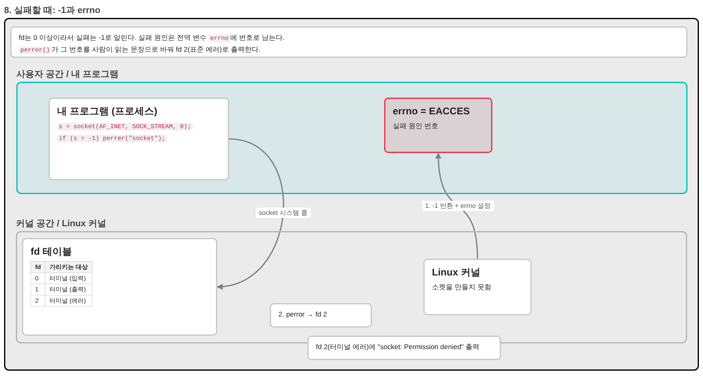

# 단계 1: 소켓을 열고 연결 하나를 받아 닫기

## 1-1. `socket()`으로 TCP 소켓을 만들고 닫기

### 무엇을 만들었나

| 파일 | 내용 |
|---|---|
| `include/net.h`, `src/net.c` | `int create_tcp_socket(void)`: `socket(AF_INET, SOCK_STREAM, 0)`으로 IPv4 TCP 소켓을 만들어 fd를 반환. 실패하면 `perror`로 errno 내용을 출력하고 -1 반환 |
| `src/main.c` | 소켓을 만들고 fd 번호를 출력한 뒤 `close` |
| `tests/test_net.c` | 반환된 fd가 0 이상인지, `close(fd)`가 0을 반환하는지 검사 |

실행 결과: `./build/server` → `socket fd = 3`

### 결정사항과 이유

| 결정 | 이유 |
|---|---|
| 소켓 생성을 `main`이 아닌 `src/net.c`의 함수로 분리 | `main`에 두면 단위 테스트에서 호출할 수 없다. 함수로 빼면 테스트 바이너리가 `main.c` 없이 `net.c`만 링크해서 검사할 수 있다. 다음 조각의 `bind`·`listen`도 같은 파일에 모은다. |
| 실패하면 -1을 그대로 반환 | `socket()` 자체가 실패 시 -1을 반환하는 POSIX 관례를 따랐다. 호출하는 쪽이 같은 방식(`== -1`)으로 검사할 수 있다. |
| 실패 원인은 `perror("socket")`로 출력 | `socket()`은 실패 원인을 전역 변수 `errno`에 남긴다. `perror`는 그 값을 사람이 읽을 수 있는 문장(예: `socket: Too many open files`)으로 바꿔 stderr에 출력한다. |
| 프로토콜 인자에 `0` | `AF_INET` + `SOCK_STREAM` 조합의 기본 프로토콜은 TCP 하나뿐이라 커널이 고르게 둔다. `IPPROTO_TCP`를 직접 써도 같다. |
| `close`의 반환값도 검사 | `close`도 실패하면 -1을 반환한다. 지금은 실패할 일이 거의 없지만, 시스템 콜 반환값을 항상 확인하는 습관을 처음부터 맞춘다. |

### 중요하다고 본 개념

아래 그림은 Obsidian 캔버스 `web-server/소켓과 TCP 연결.canvas`에서 가져왔다.

- **파일 디스크립터(fd)**: 프로세스마다 있는 fd 테이블의 칸 번호(`int`). 사용자 공간의 프로그램은 커널 공간의 객체(파일, 소켓)를 직접 만지지 못하고, 이 번호로 커널에 요청한다.
- **`socket()`이 하는 일**: 커널 안에 소켓 객체를 만들고, fd 테이블에서 비어 있는 가장 작은 번호를 그 객체에 연결해 돌려준다. 0·1·2번은 표준 입력·출력·에러가 이미 쓰고 있어서 처음 받는 번호는 보통 3이다. 실행 결과로 확인했다.
- **실패 시 -1과 `errno`**: 시스템 콜은 반환값으로 성공·실패만 알리고, 실패 원인은 `errno`에 담는다.
- **`close()`**: fd 테이블의 칸을 비우고, 그 객체를 가리키는 fd가 더 없으면 커널이 소켓 객체를 해제한다. 닫지 않으면 fd가 새는(leak) 것이고, 프로세스당 열 수 있는 fd 개수에는 상한이 있다.

### 확인한 것

| 확인 | 결과 |
|---|---|
| `make` (`-Wall -Wextra`) | 경고 0 |
| `make test` | 서버 종료 코드 0, 단위 테스트 2개 PASS |
| `make asan` (`-fsanitize=address,leak`) | 같은 테스트 모두 PASS, 오류 없음 |
| `valgrind --track-fds=yes ./build/server` | 종료 시 열린 fd는 표준 3개뿐(소켓 fd는 닫힘), 메모리 누수 0 |
| `curl -i` | 해당 없음: 아직 포트에 bind하지 않아 접속할 수 없음 |

### 아직 하지 않은 것

- `socket()`이 실패하는 경로는 일부러 일으키기 어려워 테스트하지 않았다.
- 다음 조각: `bind`(포트에 주소 붙이기) → `listen`(연결 대기) → `accept`(연결 하나 받기).
