# 단계 1: 소켓을 열고 연결 하나를 받아 닫기

## 1-1. `socket()`으로 TCP 소켓을 만들고 닫기

### 무엇을 만들었나

| 파일 | 내용 |
|---|---|
| `include/net.h`, `src/net.c` | `int create_tcp_socket(void)`: `socket(AF_INET, SOCK_STREAM, 0)`으로 IPv4 TCP 소켓을 만들어 fd를 반환. 실패하면 `perror`로 errno 내용을 출력하고 -1 반환 |
| `src/main.c` | 소켓을 만들고 fd 번호를 출력한 뒤 `close` |
| `tests/test_net.c` | 반환된 fd가 0 이상인지, `close(fd)`가 0을 반환하는지 검사 |

실행 결과: `./build/server` → `socket fd = 3`

### 결정사항과 이유

| 결정 | 이유 |
|---|---|
| 소켓 생성을 `main`이 아닌 `src/net.c`의 함수로 분리 | `main`에 두면 단위 테스트에서 호출할 수 없다. 함수로 빼면 테스트 바이너리가 `main.c` 없이 `net.c`만 링크해서 검사할 수 있다. 다음 조각의 `bind`·`listen`도 같은 파일에 모은다. |
| 실패하면 -1을 그대로 반환 | `socket()` 자체가 실패 시 -1을 반환하는 POSIX 관례를 따랐다. 호출하는 쪽이 같은 방식(`== -1`)으로 검사할 수 있다. |
| 실패 원인은 `perror("socket")`로 출력 | `socket()`은 실패 원인을 전역 변수 `errno`에 남긴다. `perror`는 그 값을 사람이 읽을 수 있는 문장(예: `socket: Too many open files`)으로 바꿔 stderr에 출력한다. |
| 프로토콜 인자에 `0` | `AF_INET` + `SOCK_STREAM` 조합의 기본 프로토콜은 TCP 하나뿐이라 커널이 고르게 둔다. `IPPROTO_TCP`를 직접 써도 같다. |
| `close`의 반환값도 검사 | `close`도 실패하면 -1을 반환한다. 지금은 실패할 일이 거의 없지만, 시스템 콜 반환값을 항상 확인하는 습관을 처음부터 맞춘다. |

### 중요하다고 본 개념

아래 그림은 Obsidian 캔버스 `web-server/소켓과 TCP 연결.canvas`에서 가져왔다.

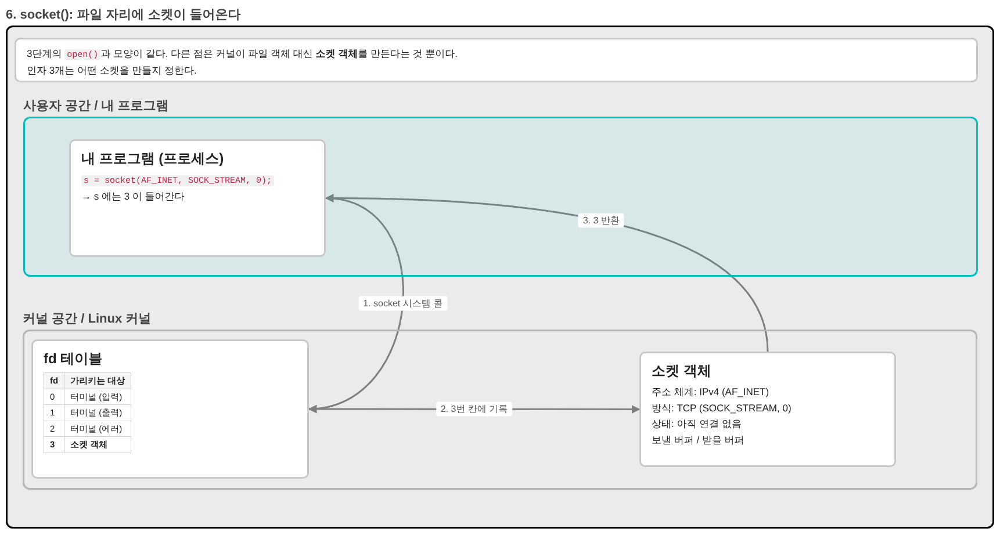


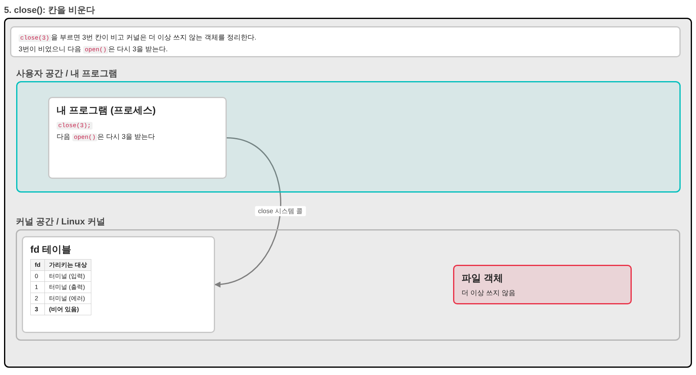

- **파일 디스크립터(fd)**: 프로세스마다 있는 fd 테이블의 칸 번호(`int`). 사용자 공간의 프로그램은 커널 공간의 객체(파일, 소켓)를 직접 만지지 못하고, 이 번호로 커널에 요청한다.
- **`socket()`이 하는 일**: 커널 안에 소켓 객체를 만들고, fd 테이블에서 비어 있는 가장 작은 번호를 그 객체에 연결해 돌려준다. 0·1·2번은 표준 입력·출력·에러가 이미 쓰고 있어서 처음 받는 번호는 보통 3이다. 실행 결과로 확인했다.
- **실패 시 -1과 `errno`**: 시스템 콜은 반환값으로 성공·실패만 알리고, 실패 원인은 `errno`에 담는다.
- **`close()`**: fd 테이블의 칸을 비우고, 그 객체를 가리키는 fd가 더 없으면 커널이 소켓 객체를 해제한다. 닫지 않으면 fd가 새는(leak) 것이고, 프로세스당 열 수 있는 fd 개수에는 상한이 있다.

### 확인한 것

| 확인 | 결과 |
|---|---|
| `make` (`-Wall -Wextra`) | 경고 0 |
| `make test` | 서버 종료 코드 0, 단위 테스트 2개 PASS |
| `make asan` (`-fsanitize=address,leak`) | 같은 테스트 모두 PASS, 오류 없음 |
| `valgrind --track-fds=yes ./build/server` | 종료 시 열린 fd는 표준 3개뿐(소켓 fd는 닫힘), 메모리 누수 0 |
| `curl -i` | 해당 없음: 아직 포트에 bind하지 않아 접속할 수 없음 |

### 아직 하지 않은 것

- `socket()`이 실패하는 경로는 일부러 일으키기 어려워 테스트하지 않았다.
- 다음 조각: `bind`(포트에 주소 붙이기) → `listen`(연결 대기) → `accept`(연결 하나 받기).

## 1-2. `bind()`로 소켓에 IP 주소와 포트를 붙이기

### 무엇을 만들었나

| 파일 | 내용 |
|---|---|
| `include/net.h`, `src/net.c` | `int bind_port(int fd, int port)`: `struct sockaddr_in`을 0으로 채우고 `AF_INET`, `htons(port)`, `htonl(INADDR_ANY)`를 넣어 `bind`. 성공 0, 실패 시 `perror("bind")` 후 -1 |
| `src/main.c` | 소켓 생성 → 8080번 포트에 bind → Enter를 누를 때까지 대기 → `close`. bind가 실패하면 fd를 닫고 종료 코드 1 |
| `tests/test_net.c` | 빈 포트 bind 성공, 같은 포트에 두 번째 bind 시 -1과 `errno == EADDRINUSE` |

실행 결과:
```
$ ./build/server
socket fd = 3
bind 성공: 0.0.0.0:8080
Enter를 누르면 소켓을 닫고 종료합니다...

(다른 터미널에서 한 번 더 실행)
$ ./build/server
socket fd = 3
bind: Address already in use
$ echo $?
1
```

### 결정사항과 이유

| 결정 | 이유 |
|---|---|
| 주소는 `struct sockaddr_in`을 직접 채운다 (`getaddrinfo` 대신) | IPv4만 지원하지만 포트·주소를 어떻게 넣는지, 바이트 순서 변환이 어디서 일어나는지가 코드에 그대로 보인다. |
| `memset(&addr, 0, sizeof(addr))` 먼저 | 지역 변수 구조체는 초기화하지 않으면 쓰레기 값이 들어 있다. 쓰지 않는 칸(`sin_zero`)까지 0으로 채워야 커널이 잘못 읽지 않는다. |
| 포트는 `htons`, 주소는 `htonl` | 네트워크 바이트 순서는 빅엔디언이고 x86은 리틀엔디언이다. 8080(0x1F90)을 그대로 넣으면 메모리에 `90 1F`로 들어가 36895번 포트가 된다. 포트는 16비트라 `s`(short), IPv4 주소는 32비트라 `l`(long). |
| 주소는 `INADDR_ANY` (0.0.0.0) | 이 컴퓨터의 모든 IPv4 주소(127.0.0.1, 랜 IP 등)로 오는 연결을 받는다. 127.0.0.1만 쓰면 다른 컴퓨터에서 접속할 수 없다. |
| bind 실패 시 `close(fd)` 후 종료 | 이미 만든 소켓 fd를 닫지 않고 끝내면 fd가 새는 습관이 생긴다. 실패 경로에서도 자원을 정리한다. |
| `perror` 앞뒤로 `errno`를 저장·복원 | 테스트에서 `perror` 뒤에 `errno`가 `EADDRINUSE`(98)가 아니라 `EINVAL`(22)로 바뀌어 있는 것을 확인했다. `perror`도 내부에서 다른 함수를 부르기 때문에 `errno`를 덮어쓸 수 있다. 호출한 쪽이 원인을 구분할 수 있게 되돌린다. |
| Enter 대기 (임시) | bind하고 바로 끝나면 포트도 바로 풀려서 두 번째 실행으로 `EADDRINUSE`를 볼 수 없다. 다음 조각(`listen`·`accept`)에서 지운다. `make test`는 `< /dev/null`로 빈 입력을 줘서 바로 넘어간다. |
| 테스트 포트는 18080 | 서버 기본 포트 8080이 다른 프로그램에 잡혀 있어도 테스트가 깨지지 않게 분리했다. |

### 중요하다고 본 개념

- **IP 주소와 포트**: IP 주소는 네트워크에서 컴퓨터를, 포트(0~65535, 16비트)는 그 컴퓨터 안의 프로그램(소켓)을 가리킨다. `bind`는 "이 소켓은 이 주소의 이 포트로 오는 연결을 맡는다"고 커널에 등록하는 일이다.
- **`struct sockaddr_in`과 형변환**: `bind`는 여러 주소 체계를 받으려고 범용 타입 `struct sockaddr *`를 받는다. IPv4 구조체를 `(struct sockaddr *)`로 바꿔 넘기고, 크기를 `sizeof(addr)`로 알려 준다.
- **네트워크 바이트 순서**: 여러 바이트로 된 숫자는 빅엔디언으로 넣는다. `htons`·`htonl`이 호스트 순서를 네트워크 순서로 바꾼다.
- **`EADDRINUSE`**: 같은 주소·포트에 이미 bind된 소켓이 있으면 두 번째 bind는 실패한다. 포트 하나는 한 소켓만 맡을 수 있다.
- **`EACCES`**: 1024 미만 포트(예: 80)는 관리자 권한이 있어야 bind할 수 있다.

#### 학습 캔버스 그림 (2. IP 주소, 포트, TCP 연결)

**1. IP 주소: 호스트를 가리키는 번호**

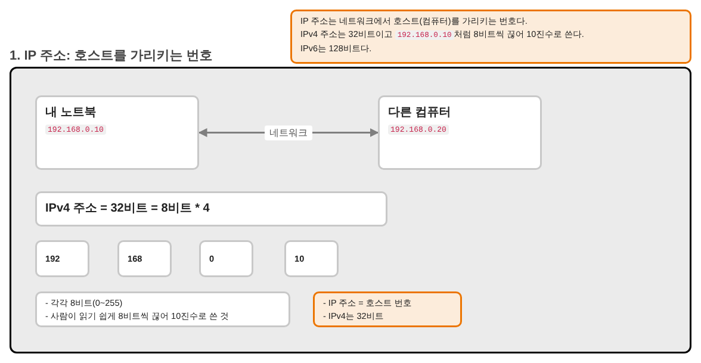

**2. 인터페이스, 루프백, INADDR_ANY**

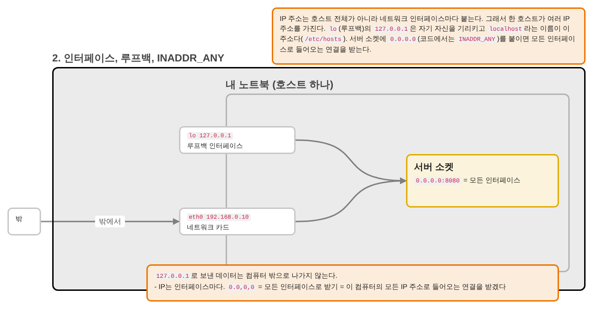

**3. 포트: 호스트 안에서 소켓을 고르는 번호**

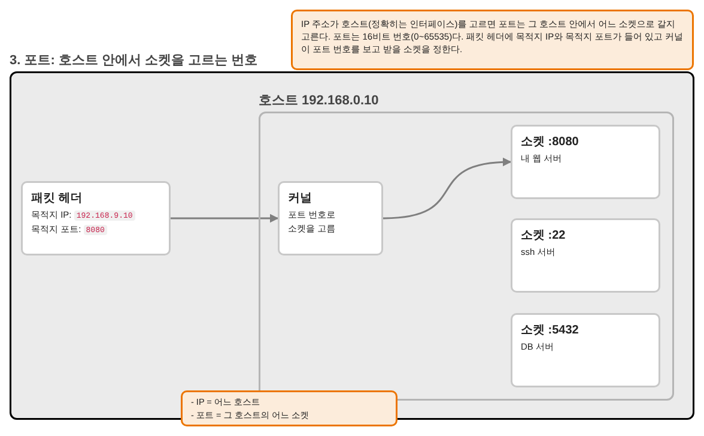

**4. 포트 번호의 구역**

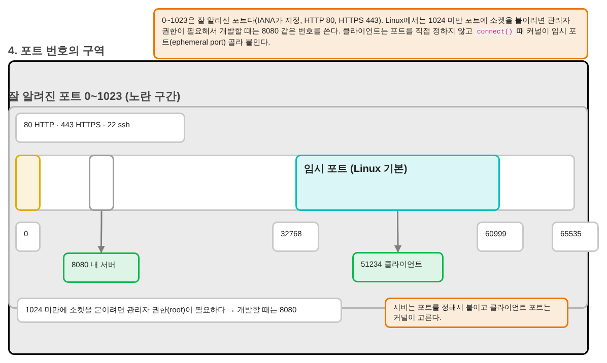

**5. 소켓 주소와 소켓 쌍**

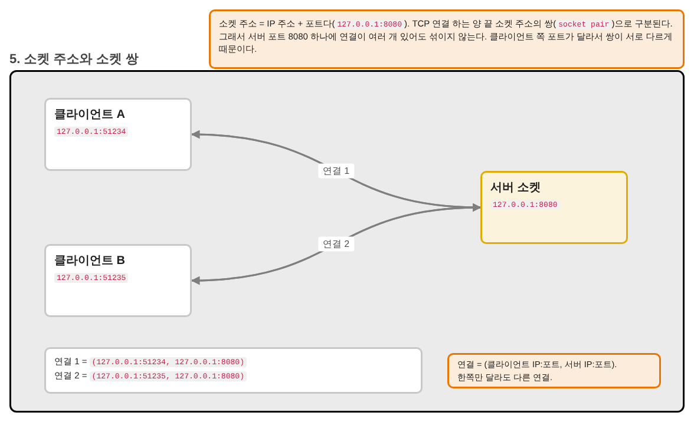

**6. 3-way handshake: 연결을 맺는 패킷 세 개**

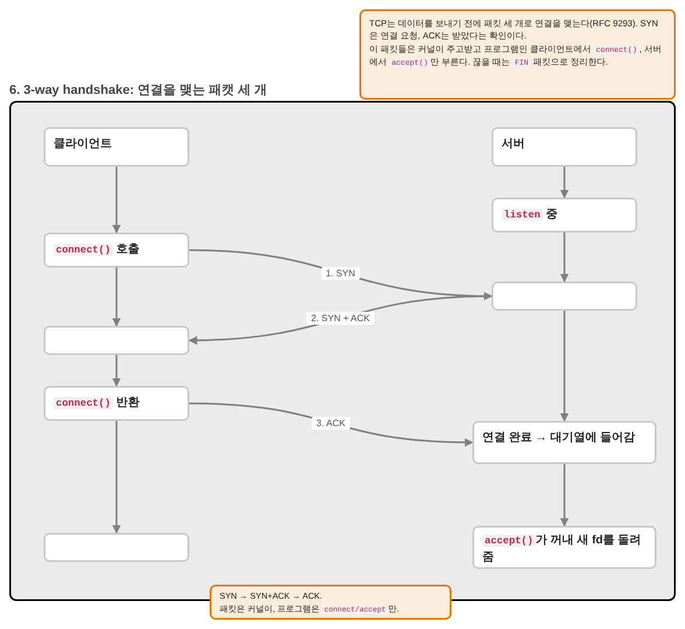

**7. 바이트 순서 (엔디언)**

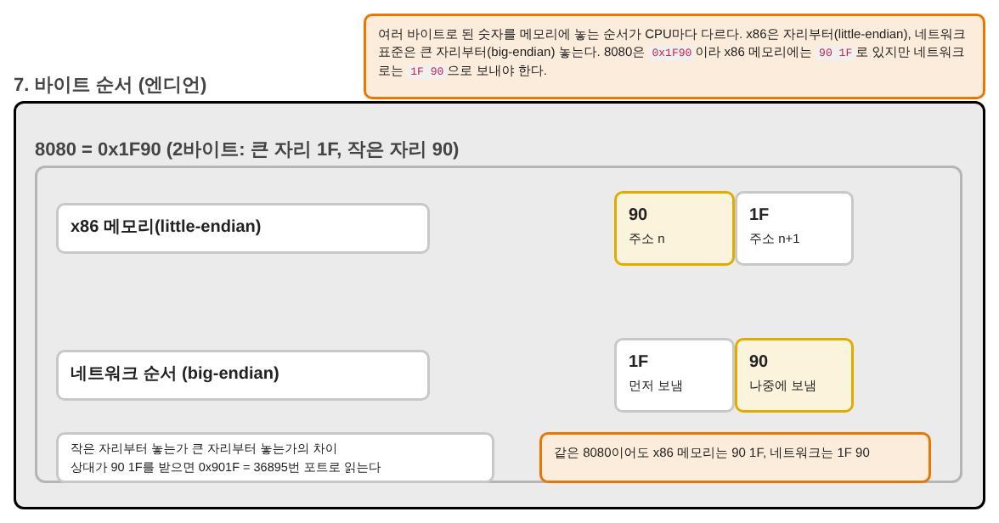

**8. htons / htonl: 네트워크 순서로 바꾸는 함수**

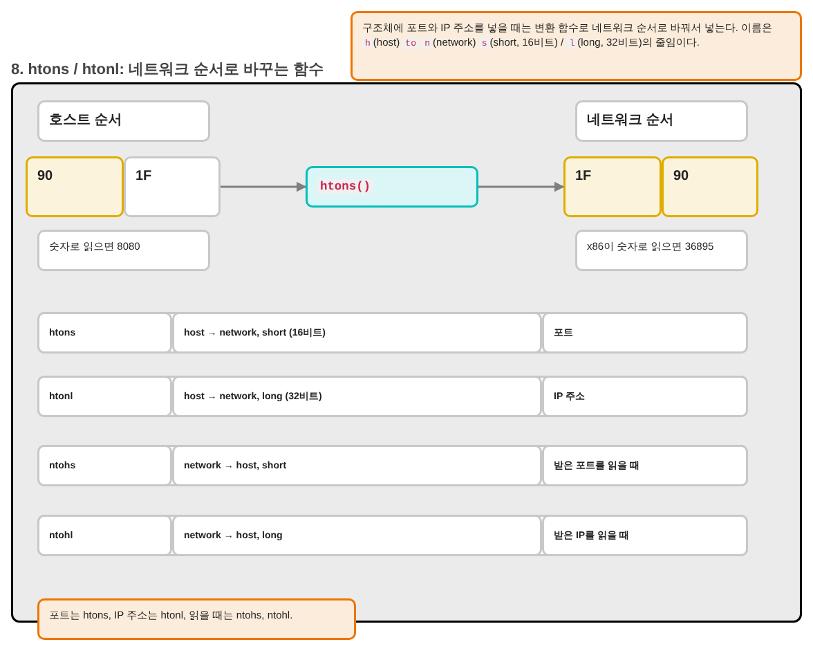

**9. struct sockaddr_in: 소켓 주소를 담는 구조체**

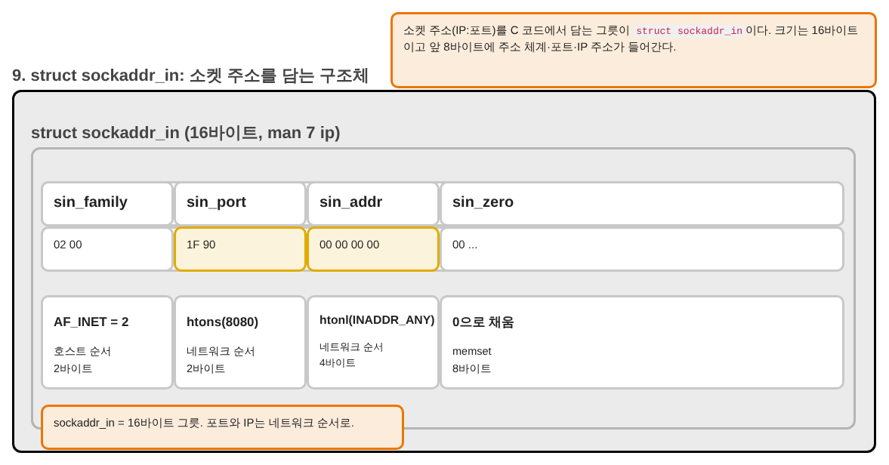

**10. 코드 흐름 ①: 구조체 채우기**

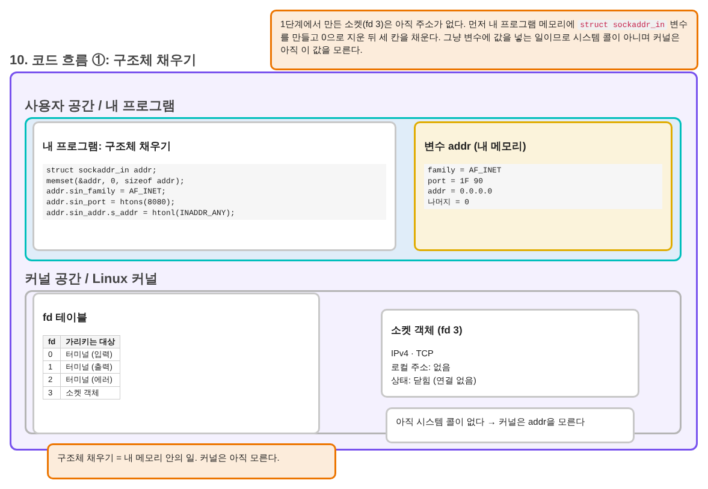

**11. 코드 흐름 ②: bind()로 소켓에 주소 붙이기**

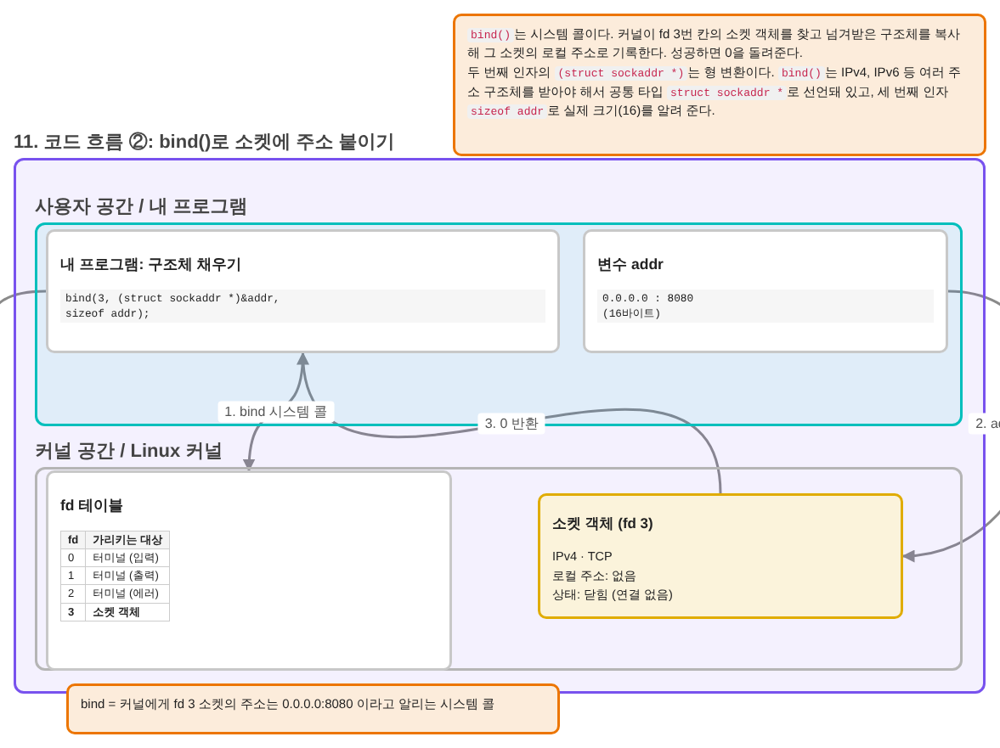

**12. bind가 실패할 때**

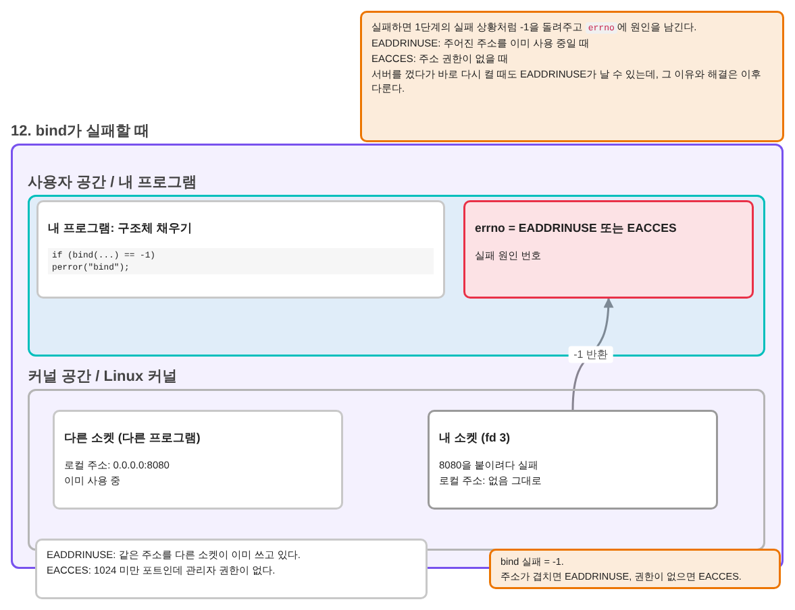

**13. 지금 어디까지 왔나**

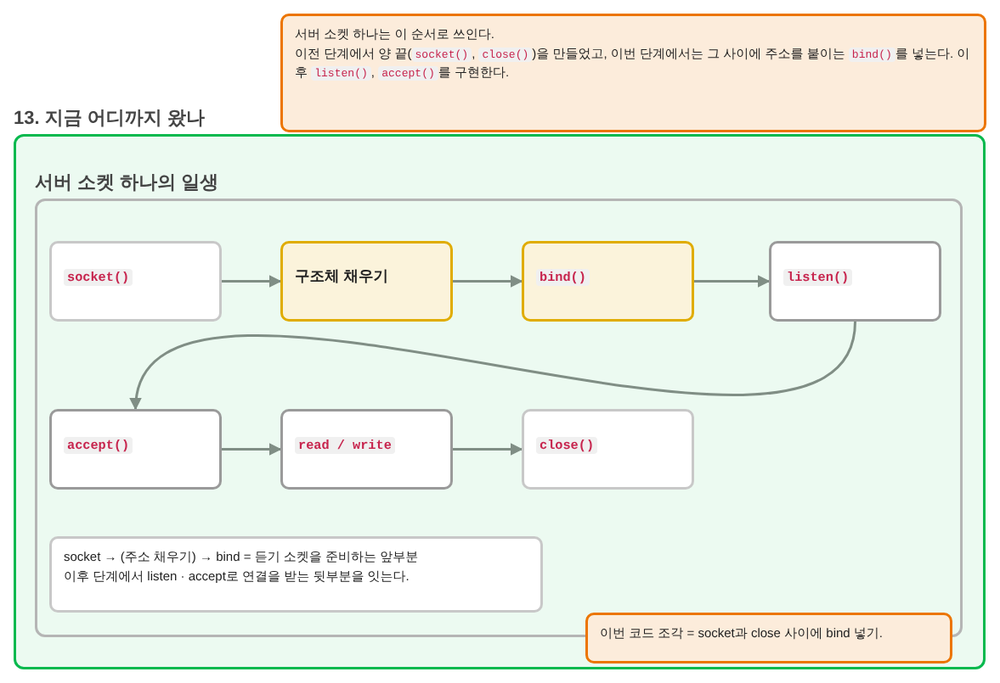

**보충. 코드 한 줄씩 풀이 (addr 멤버, htons, bind 인자, 커널에서 본 흐름)**

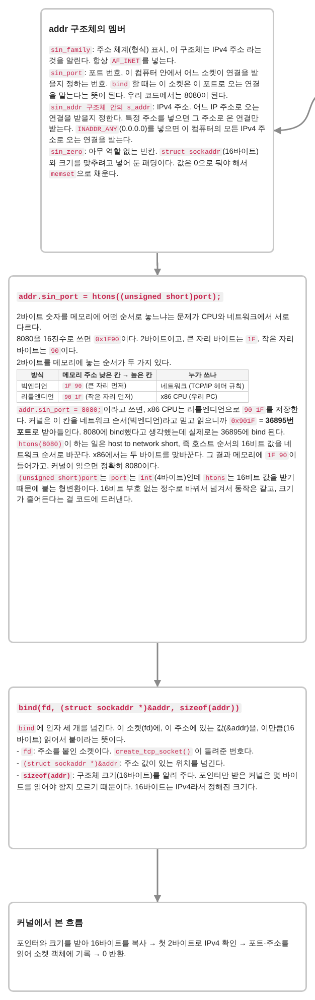

### 확인한 것

| 확인 | 결과 |
|---|---|
| `make` (`-Wall -Wextra`) | 경고 0 |
| `make test` | PASS 7줄 (서버 종료 코드 1개 + 단위 테스트 6개) (`bind: Address already in use` 출력은 의도한 실패 테스트) |
| `make asan` | 같은 테스트 모두 PASS, 오류 없음 |
| 두 번 동시에 실행 | 두 번째가 `bind: Address already in use`, 종료 코드 1 |
| `valgrind --track-fds=yes ./build/server < /dev/null` | 종료 시 열린 fd는 표준 3개뿐, 메모리 누수 0 |
| `EACCES` | 작업 환경이 root라 재현 불가. 일반 사용자 계정에서 `src/main.c`의 `PORT`를 80으로 바꿔 실행하면 `bind: Permission denied`가 나와야 한다 |
| `curl -i` | 해당 없음: 아직 `listen`하지 않아 연결을 받을 수 없음 |

### 아직 하지 않은 것

- 다음 조각: `listen`(연결 대기열 만들기) → `accept`(연결 하나 받기). 그때 Enter 대기를 지운다.
- 서버를 끄자마자 다시 켜면 `EADDRINUSE`가 날 수 있는 문제(`SO_REUSEADDR`)는 `listen`·`accept` 이후에 다룬다.
