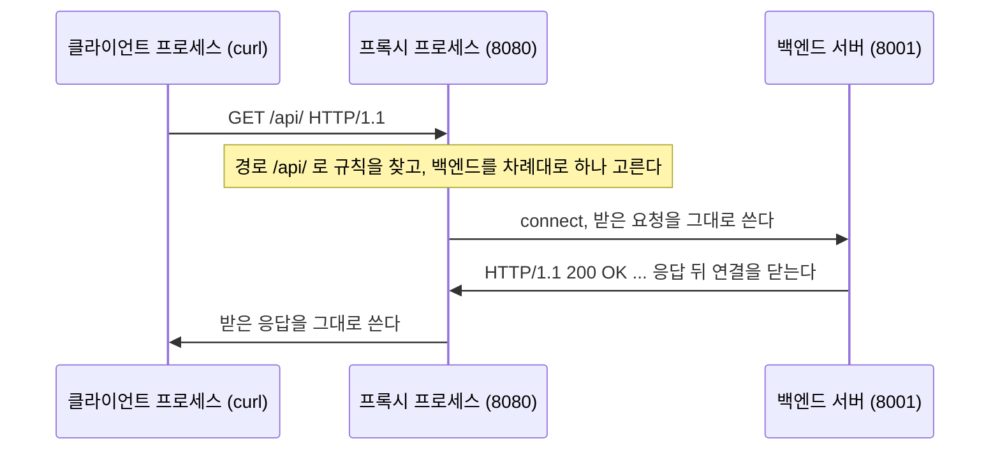

# 단계 11~13: 간단한 Reverse Proxy

## 무엇을 만들었나

`build/proxy`는 클라이언트 프로세스의 요청을 받아 백엔드 서버 중 하나에 그대로 전달하고, 백엔드의 응답을 클라이언트 프로세스에게 돌려주는 프로그램이다. 웹 서버(`build/server`)와 별개의 실행 파일이고, 코드는 `proxy/` 폴더에 있다. `src/`의 `net.c`, `http.c`, `response.c`를 함께 쓴다.

| 파일 | 내용 |
|---|---|
| `proxy/main.c` | 설정 파일을 읽고, `socket` → `bind` → `listen` 뒤 `accept` → `proxy_connection` → `close`를 반복한다 |
| `proxy/proxy.c` | `load_config`, `match_route`, `pick_backend`, `connect_backend`, `proxy_connection` |
| `proxy/proxy.h` | 위 함수 선언과 `struct backend`, `struct route`, `struct proxy_config` |
| `proxy.conf` | 라우팅 규칙 |

## 요청 하나의 흐름



`proxy_connection`의 순서:

1. `read_request_head`로 클라이언트의 요청 줄과 헤더를 읽는다.
2. `parse_request_line`, `split_target`으로 경로를 꺼내고 `match_route`로 규칙을 찾는다. 맞는 규칙이 없으면 404.
3. `pick_backend`로 백엔드를 차례대로 하나 고르고(라운드로빈) `connect_backend`로 연결한다. 연결하지 못하면 502.
4. 받은 요청을 그대로 백엔드에 쓴다.
5. `Content-Length`를 보고 본문이 더 남았으면 클라이언트에서 읽어 백엔드로 옮긴다.
6. 백엔드가 연결을 닫을 때까지 응답을 읽어 클라이언트에게 그대로 쓴다. 아무것도 오지 않았으면 502.

## 설정 파일

```
/api/    127.0.0.1:8001 127.0.0.1:8003
/static/ 127.0.0.1:8002
```

한 줄에 규칙 하나다. 첫 칸은 경로 접두사, 나머지는 백엔드 `주소:포트`다. 경로가 접두사로 시작하면 그 줄의 백엔드로 보낸다. 백엔드가 여러 개면 요청마다 차례대로 돌아가며 보낸다. 위에 적힌 규칙이 먼저 적용된다.

## 직접 실행 (WSL 터미널 다섯 개)

```bash
make
./build/server 8001 demo/proxy/backend1    # 터미널 1
./build/server 8002 demo/proxy/backend2    # 터미널 2
./build/server 8003 demo/proxy/backend3    # 터미널 3
./build/proxy 8080 proxy.conf              # 터미널 4
```

터미널 5:

```bash
curl localhost:8080/api/       # 백엔드 8001이 보낸 /api/ 응답
curl localhost:8080/api/       # 백엔드 8003이 보낸 /api/ 응답
curl localhost:8080/static/    # 백엔드 8002가 보낸 /static/ 응답
curl -i localhost:8080/other   # 404 (맞는 규칙 없음)
```

터미널 1을 Ctrl+C로 끄고 `curl -i localhost:8080/api/`를 두 번 보내면 한 번은 502, 한 번은 8003의 응답이 온다.

## 한계

- 한 번에 연결 하나씩 처리한다. 느린 요청 하나가 다른 요청을 기다리게 한다.
- 응답의 끝을 "백엔드가 연결을 닫음"으로 안다. 응답 뒤에 연결을 닫지 않는 백엔드에서는 끝나지 않는다. 이 프로젝트의 웹 서버는 응답마다 연결을 닫는다.
- 백엔드 주소는 IPv4 숫자 주소만 된다 (`localhost` 같은 이름은 안 된다).
- 꺼진 백엔드도 순번에서 빠지지 않는다 (헬스 체크 없음).
- 요청과 응답의 헤더를 고치지 않는다 (`X-Forwarded-For` 없음).
