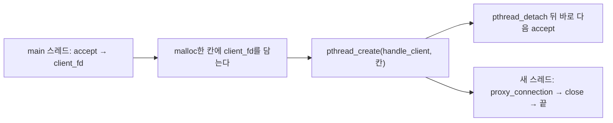

# 단계 14: 프록시가 연결마다 스레드를 만든다

## 어떤 문제가 있었나

프록시 프로세스는 `accept`로 받은 연결의 처리(`proxy_connection`)가 끝나야 다음 `accept`로 돌아갔다.
그래서 처리에 2초 걸리는 요청이 하나 있으면, 그 뒤에 온 클라이언트는 금방 끝날 요청이어도 2초를 기다렸다.

## 어떻게 풀었나

`accept` 직후에 스레드를 하나 만들어 그 연결을 맡기고, main 스레드는 바로 다음 `accept`로 돌아간다.



## 내린 결정과 이유

| 결정 | 이유 |
|---|---|
| fork가 아니라 스레드 | 프록시는 Round-Robin 순번(`next`)을 모든 연결이 함께 써야 한다. fork는 메모리를 복사하므로 자식 프로세스가 올린 순번이 부모에게 반영되지 않는다. 스레드는 같은 메모리를 쓴다 |
| 잠금은 `pick_backend`의 두 줄에만 | 요청마다 값이 바뀌는 공유 변수는 `next` 하나뿐이다. 설정의 나머지는 시작할 때 채운 뒤 읽기만 한다. 연결 처리 전체를 잠그면 다시 한 번에 하나만 처리하게 된다 |
| `pthread_join` 대신 `pthread_detach` | main 스레드는 `accept`에서 기다려야 하므로 끝난 스레드를 기다릴 수 없다 |

## 중요한 개념

| 개념 | 코드 | 설명 |
|---|---|---|
| 새 스레드에 값 넘기기 | `proxy/main.c`의 `struct client_arg`, `handle_client` | `pthread_create`는 포인터 하나만 넘긴다. 지역 변수 `client_fd`의 주소를 넘기면 새 스레드가 읽기 전에 main 스레드가 다음 `accept`로 덮어쓸 수 있어서, 연결마다 `malloc`한 칸에 담아 넘기고 새 스레드가 `free`한다 |
| 잠금(mutex) | `proxy/proxy.c`의 `next_lock`, `pick_backend` | 순번을 읽고 1 올리는 두 줄 사이에 다른 스레드가 끼어들면 두 요청이 같은 백엔드로 간다. `pthread_mutex_lock`과 `pthread_mutex_unlock`으로 그 두 줄을 한 번에 한 스레드만 실행하게 한다 |
| detach | `proxy/main.c`의 `pthread_detach` | 끝난 스레드의 스택과 반환값은 누군가 `pthread_join`으로 가져갈 때까지 남는다. detach해 두면 끝날 때 자동으로 정리된다 |

## 실행 방법

터미널 네 개를 쓴다. 모두 레포 맨 위 폴더에서 실행한다.

```bash
# 터미널 1: 백엔드 (CGI 프로그램이 있는 폴더 www)
make && ./build/server 8002 www
```

```bash
# 터미널 2: 프록시
printf '/cgi-bin/ 127.0.0.1:8002\n/ 127.0.0.1:8002\n' > /tmp/thread.conf
./build/proxy 8080 /tmp/thread.conf
```

```bash
# 터미널 3: 5초 동안 연결만 하고 아무것도 보내지 않는 클라이언트 (느린 클라이언트)
sleep 5 | nc localhost 8080
```

```bash
# 터미널 4: 터미널 3이 멈춰 있는 동안 실행한다. 기다리지 않고 바로 응답이 온다
time curl -s -o /dev/null localhost:8080/index.html
```

단계 13까지의 프록시는 터미널 4의 요청이 터미널 3의 연결이 끝날 때까지(5초) 기다렸다.

스레드가 생겼다 없어지는 것은 `ps -eLf | grep build/proxy`로 본다. 프로세스는 하나이고, 연결을 처리하는 동안 줄(스레드)이 늘어난다.

## 테스트

`tests/run_proxy_tests.sh`의 "연결마다 스레드" 부분.

- 2초 걸리는 요청이 처리되는 동안 보낸 빠른 요청이 1초 안에 끝난다.
- 동시에 보낸 `/api/` 요청 40개가 두 백엔드에 20개씩 간다.

## 한계

- 연결 수에 제한이 없다. 연결이 아주 많으면 스레드도 그만큼 생긴다 (스레드 풀 없음).
- 클라이언트가 연결만 하고 아무것도 보내지 않으면 그 스레드는 계속 `read`에서 기다린다 (제한 시간 없음).
