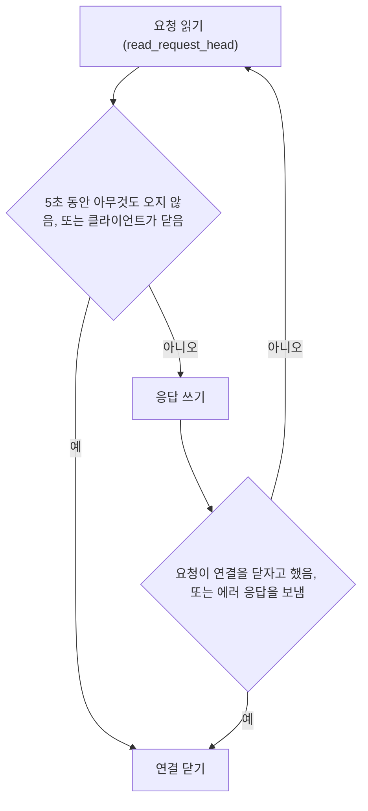

# 단계 15: keep-alive (연결 하나에서 요청 여러 개)

## 어떤 문제가 있었나

웹 서버는 응답 하나를 보내면 연결을 닫았다. 페이지 하나에 HTML, CSS, JS, 이미지가 있으면 클라이언트는 파일마다 TCP 연결을 새로 맺어야 한다.
연결을 맺을 때마다 패킷 세 개(SYN, SYN+ACK, ACK)가 오가고, 웹 서버 프로세스는 `fork`를 한 번 더 한다.

## 어떻게 풀었나

응답을 보낸 뒤 연결을 닫지 않고, 같은 연결(`conn_fd`)에서 다음 요청을 읽는다.



## 유지할지 닫을지 정하는 규칙 (RFC 9112 9.3절)

| 요청의 버전 | Connection 헤더 | 응답 뒤 |
|---|---|---|
| HTTP/1.1 | 없음 | 유지 |
| HTTP/1.1 | `close` | 닫기 |
| HTTP/1.0 | 없음 | 닫기 |
| HTTP/1.0 | `keep-alive` | 유지 |

코드는 `src/http.c`의 `wants_keep_alive`다. 웹 서버와 프록시가 함께 쓴다.

## 중요한 개념

| 개념 | 코드 | 설명 |
|---|---|---|
| 요청의 경계 | `src/handler.c`의 `handle_connection`, `receive_body` | TCP에는 "요청 하나가 여기까지"라는 표시가 없다. 헤더는 빈 줄까지, 본문은 `Content-Length`바이트까지다. 한 번의 `read`에 다음 요청의 앞부분이 함께 들어올 수 있어서, 이 요청이 쓴 만큼만 버리고 나머지는 버퍼 맨 앞으로 옮겨(`memmove`) 다음 바퀴에서 이어 쓴다 |
| 응답의 경계 | `Content-Length` 헤더 | 연결을 닫지 않으므로 클라이언트는 "연결이 닫힘"으로 응답의 끝을 알 수 없다. 모든 응답(정적 파일, CGI, 에러)에 `Content-Length`가 있어야 한다 |
| 유휴 제한 시간 | `setsockopt(SO_RCVTIMEO)` 5초 | 클라이언트가 다음 요청을 보내지 않고 연결만 잡고 있으면 자식 프로세스가 끝나지 않는다. `read`가 5초 넘게 멈추면 -1(`EAGAIN`)로 돌아오게 해서 연결을 닫는다 |
| `TCP_NODELAY` | `setsockopt(TCP_NODELAY)` | 응답을 헤더와 본문 두 번의 `write`로 보낸다. 커널은 작은 데이터를 모아 보내려고 둘째 `write`를 붙잡아 두는데, 유지된 연결에서는 이 때문에 응답이 약 40ms 늦어졌다. 이 옵션으로 바로 보내게 한다 |

## 내린 결정과 이유

| 결정 | 이유 |
|---|---|
| 에러 응답 뒤에는 항상 닫는다 | 411, 413 같은 에러는 본문을 읽지 않고 응답하므로 다음 요청이 어디서 시작하는지 알 수 없다. 경계가 분명한 404도 같은 규칙으로 닫아 코드를 단순하게 둔다 |
| 프록시는 클라이언트와의 연결만 유지한다 | 프록시와 서버 사이의 연결까지 유지하려면 연결을 보관하고 다시 꺼내 쓰는 구조(connection pool)가 필요하다. 이 단계에서는 하지 않는다 (단계 19에서 했다: `docs/step19.md`) |
| 프록시는 서버에 항상 `HTTP/1.0` + `Connection: close`로 요청한다 | 프록시는 서버가 연결을 닫는 것으로 응답의 끝을 안다. 서버가 연결을 유지하면 프록시가 서버의 유휴 제한 시간(5초)까지 기다리게 된다 |
| 프록시는 서버 응답의 `Connection: close`를 `keep-alive`로 바꿔 보낸다 | 서버와의 연결은 닫히지만 클라이언트와의 연결은 유지하므로, 서버의 헤더를 그대로 옮기면 클라이언트가 연결을 닫아 버린다 |
| 서버 응답에 `Content-Length`가 없으면 프록시도 클라이언트와의 연결을 닫는다 | 클라이언트가 응답의 끝을 알 방법이 "연결이 닫힘"뿐이다 |

## 실행 방법

```bash
# 터미널 1
make && ./build/server 8080 www
```

```bash
# 터미널 2: URL 두 개를 주면 curl이 두 번째 요청에 연결을 다시 쓴다
curl -v http://localhost:8080/index.html http://localhost:8080/style.css -o /dev/null -o /dev/null 2>&1 | grep -E "Re-using|Connection:"
```

`Re-using existing connection`이 나오고, 터미널 1에 `이 연결의 2번째 요청`이 찍힌다.

```bash
# 터미널 2: HTTP/1.0(-0)은 닫기가 기본이다. Re-using이 나오지 않고 Connection: close가 나온다
curl -0 -v http://localhost:8080/index.html http://localhost:8080/style.css -o /dev/null -o /dev/null 2>&1 | grep -E "Re-using|Connection:"
```

```bash
# 터미널 2: 요청 하나를 직접 적어 보내고 가만히 있는다. 5초 뒤 서버가 연결을 닫는다
nc localhost 8080
GET / HTTP/1.1
Host: localhost

```

터미널 1에 `5초 동안 요청이 없어 연결을 닫습니다`가 찍힌다.

## 테스트

- `tests/run_tests.sh`의 "keep-alive" 부분: 요청 두 개를 연결 하나에서 처리, HTTP/1.0과 `Connection` 헤더 규칙, POST 본문 뒤에 붙어 온 다음 요청, 에러 뒤 닫기, curl의 연결 재사용, 5초 유휴 제한 시간.
- `tests/run_proxy_tests.sh`의 "keep-alive" 부분: 같은 검사를 프록시를 거쳐서 하고, 유지된 연결의 요청도 백엔드를 번갈아 고르는지 본다.
- `tests/test_http.c`: `read_request_head`가 버퍼에 이미 들어 있는 바이트부터 보는지.

## 한계

- 프록시와 서버 사이의 연결은 요청마다 새로 맺는다 (connection pool 없음).
- 유지된 연결 하나가 웹 서버의 자식 프로세스 하나(프록시는 스레드 하나)를 최대 5초 동안 잡고 있다.
- 한 연결에서 처리하는 요청 수에 제한이 없다.
