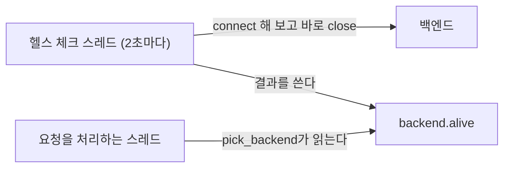

# 단계 16: 헬스 체크와 자동 제외

## 어떤 문제가 있었나

`/api/` 규칙의 백엔드가 8001, 8003 둘인데 8003을 끄면, 프록시 프로세스는 8003이 꺼진 줄 모르고 계속 번갈아 고른다.
8003 차례인 요청은 `connect`가 실패해 502가 된다. 클라이언트는 200과 502를 번갈아 받는다.

## 어떻게 풀었나



| 생각 | 내용 | 코드 |
|---|---|---|
| 1. 문제 | 꺼진 백엔드를 계속 골라 200과 502가 번갈아 나온다 | (고치기 전 `pick_backend`) |
| 2. 헬스 체크 | 프록시 프로세스가 스레드 하나를 더 만든다. 이 스레드가 2초마다 모든 백엔드에 `connect`만 해 보고 바로 `close`한다. 연결되면 살아 있음, 안 되면 죽음 | `proxy/main.c`의 `health_loop`, `proxy/proxy.c`의 `check_backends` |
| 3. 자동 제외 | `struct backend`에 `alive`를 둔다. `pick_backend`는 `next`부터 한 바퀴만 보면서 `alive`가 0인 백엔드를 건너뛴다. 모두 죽었으면 `NULL`을 돌려주고 프록시는 503을 보낸다 | `proxy/proxy.h`의 `struct backend`, `proxy/proxy.c`의 `pick_backend`, `proxy_request` |
| 3-1. failover | 헬스 체크가 알아채기 전에 죽은 백엔드를 골랐다면 `connect`가 실패한다. 그 백엔드의 `alive`를 바로 0으로 바꾸고(`mark_backend_dead`) 다음 백엔드로 다시 시도한다. 클라이언트는 에러를 받지 않는다 (준호의 리뷰로 추가) | `proxy/proxy.c`의 `mark_backend_dead`, `proxy_request` |
| 4. 자동 복귀 | 죽은 백엔드에도 계속 `connect`해 본다. 연결되면 `alive`를 1로 되돌린다 | `check_backends` |
| 5. 잠금 | `alive`는 헬스 체크 스레드가 쓰고 요청을 처리하는 스레드들이 읽는다. 순번(`next`)을 지키던 `next_lock`으로 함께 지킨다. `connect`는 잠금 밖에서 하고, 값을 쓸 때만 잠금을 잡는다 | `check_backends`, `pick_backend` |

## 502와 503

| 상태 코드 | 언제 |
|---|---|
| 502 Bad Gateway | Forward Proxy에서 클라이언트가 정한 서버에 `connect`했는데 실패했다. 대신 보낼 다른 서버가 없다 |
| 503 Service Unavailable | Reverse Proxy에서 규칙의 백엔드 중 살아 있는 것이 없다. 처음부터 모두 `alive == 0`이었거나, 시도한 백엔드가 모두 `connect`에 실패했다 |

## 내린 결정과 이유

| 결정 | 이유 |
|---|---|
| 검사 간격 2초 (`HEALTH_INTERVAL_SEC`) | 짧을수록 빨리 알아채지만 백엔드에 연결을 더 자주 건다. 시연에서 기다릴 만한 길이로 정했다 |
| 처음 값은 `alive = 1` | 프록시가 시작하자마자 헬스 체크 스레드가 첫 검사를 하므로 곧 실제 값으로 바뀐다. 0으로 시작하면 첫 검사가 끝나기 전의 요청이 503이 된다 |
| 검사는 `connect`만 | 프로세스가 포트를 듣고 있는지만 본다. `GET /health` 같은 요청을 보내 응답까지 확인하는 방식과, 연속으로 몇 번 실패해야 죽음으로 보는 기준은 넣지 않았다 |
| 값이 바뀔 때만 `[Health]` 줄을 출력 | 2초마다 출력하면 다른 로그가 묻힌다 |
| Forward Proxy의 목적지는 검사하지 않음 | 목적지를 클라이언트가 요청마다 정하므로 미리 검사할 목록이 없다 |

## 실행 방법

```bash
# 터미널 1, 2, 3: 백엔드 둘과 프록시
./build/server 8001 demo/proxy/backend1
./build/server 8003 demo/proxy/backend3
./build/proxy 8080 proxy.conf

# 터미널 4: 상태 코드만 네 번 출력한다
for i in 1 2 3 4; do curl -s -o /dev/null -w "%{http_code}\n" http://localhost:8080/api/; done
```

터미널 2의 백엔드 8003을 Ctrl+C로 끄고 2초 뒤 터미널 4의 명령을 다시 실행하면 네 번 모두 200이다.
프록시 출력에 `[Health] 127.0.0.1:8003 연결 실패 → 요청을 보내지 않음 (자동 제외)`가 찍힌다.
8003을 다시 켜면 2초 안에 `[Health] 127.0.0.1:8003 연결됨 → 다시 요청을 보냄 (자동 복귀)`가 찍힌다.

## 테스트

- `tests/test_proxy.c`: `pick_backend`가 죽은 백엔드를 건너뛰는지, 모두 죽었으면 `NULL`인지
- `tests/run_proxy_tests.sh`의 "헬스 체크와 자동 제외": 백엔드를 끄고 켜면서 요청이 어디로 가는지, 503

## 한계

- `connect`에 제한 시간이 없다. 지금은 백엔드가 모두 `127.0.0.1`이라 꺼져 있으면 `connect`가 바로 실패하지만, 응답하지 않는 다른 컴퓨터를 백엔드로 적으면 `connect`가 오래 멈춘다.
- `connect`가 실패한 이유를 구분하지 않는다. 프록시 프로세스의 fd가 부족해서 실패해도 백엔드가 죽은 것으로 본다.
- 백엔드의 웹 서버 프로세스는 헬스 체크 연결도 보통 연결처럼 받는다. 2초마다 `fork`를 한 번 하고 "헤더가 끝나기 전에 연결이 닫혔습니다"를 출력한다.
- 포트는 듣고 있지만 응답을 못 하는 백엔드(멈춘 프로세스)는 살아 있다고 본다.
