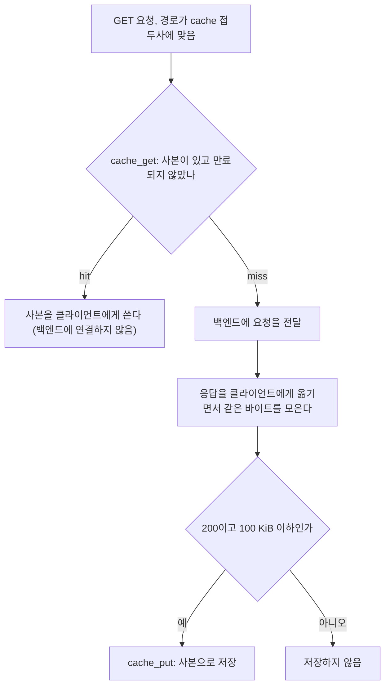

# 단계 17: 응답 캐싱 (기본)

## 어떤 문제가 있었나

같은 `GET` 요청이 여러 번 와도 프록시 프로세스는 매번 백엔드에 연결해 응답을 받아 왔다.
백엔드가 응답 하나를 만드는 데 3초가 걸리면(느린 CGI) 같은 요청 세 번에 9초가 걸린다.

## 어떻게 풀었나

프록시 프로세스가 백엔드의 응답 바이트(상태 줄, 헤더, 본문)를 자기 메모리에 사본으로 둔다.
같은 요청이 다시 오면 백엔드에 연결하지 않고 사본을 클라이언트에게 쓴다.



| 생각 | 내용 | 코드 |
|---|---|---|
| 1. 문제 | 같은 요청을 매번 백엔드가 처리한다 | |
| 2. 사본과 키 | 사본은 응답 바이트 그대로다. 키는 요청 대상 전체(`?` 뒤의 쿼리 포함)다. hit면 서버를 고르지도 연결하지도 않는다 | `proxy/proxy.c`의 `proxy_request` 0단계, `proxy/cache.c`의 `cache_get` |
| 3. 무엇을 저장하나 | `GET` 요청의 200 응답만. `POST`, 404, 502, 503은 저장하지 않는다. `Content-Length`가 있는데 본문이 그만큼 오지 않은 응답도 저장하지 않는다 | `proxy/proxy.c`의 `is_cacheable` |
| 4. TTL | 사본은 10초 동안만 쓴다(`CACHE_TTL_MS`). 시계는 `CLOCK_MONOTONIC`이다. 컴퓨터의 날짜와 시각을 바꿔도 거꾸로 가지 않는다 | `proxy/cache.c`의 `now_ms`, `cache_get` |
| 5. 크기 제한 | 사본 하나는 100 KiB까지(넘으면 모으기를 그만두고 저장하지 않는다), 전체는 1 MiB까지. 넘치면 가장 오래 쓰지 않은 사본부터 버린다(LRU) | `proxy/proxy.c`의 `copy_append`, `proxy/cache.c`의 `cache_put` |
| 6. 잠금 | 캐시는 여러 스레드가 함께 쓴다. `cache_lock`(백엔드 순번의 `next_lock`과 별도)으로 지킨다. hit: 잠금 안에서 사본을 복사하고, 잠금을 푼 뒤 클라이언트에게 쓴다. miss: 잠금 없이 응답을 모으고, 저장할 때만 잠금을 잡는다 | `proxy/cache.c`의 `cache_get`, `cache_put` |

## 내린 결정과 이유

| 결정 | 이유 |
|---|---|
| 캐시할 경로를 설정 파일에 적는다 (`cache /static/`) | 모든 `GET`을 캐시하면 `/api/` 요청이 백엔드에 가지 않아 라운드로빈, 헬스 체크, failover가 보이지 않는다. 적지 않은 경로는 캐시를 보지 않는다 |
| Forward Proxy 요청은 캐시하지 않는다 | 요청 대상이 `http://`로 시작해서 `cache` 접두사(`/`로 시작)에 맞지 않는다 |
| hit 때 사본을 복사해서 쓴다 | 잠금을 잡은 채 클라이언트에게 `write`하면 느린 클라이언트 하나가 캐시 전체를 붙잡는다. 잠금을 풀면 그 사본이 다른 스레드에 의해 버려질 수 있으므로 복사본으로 쓴다 |
| 저장할 때 잠금 안에서 키로 다시 찾는다 | 같은 요청을 두 스레드가 동시에 miss하고 둘 다 저장해도 사본이 하나만 남는다 |
| TTL 10초, 사본 100 KiB, 전체 1 MiB | 시연에서 hit과 만료를 한 장면에 볼 수 있는 길이. 크기는 CSAPP proxylab과 같은 값 |

## 실행 방법

```bash
# 터미널 1, 2: 백엔드와 프록시 (proxy.conf에 "cache /static/"이 있다)
./build/server 8002 demo/proxy/backend2
./build/proxy 8080 proxy.conf

# 터미널 3: 같은 요청을 두 번
curl -s -o /dev/null http://localhost:8080/static/
curl -s -o /dev/null http://localhost:8080/static/
```

프록시 출력에 차례로 찍힌다.

```
[Cache] MISS /static/
[Reverse] GET /static/ → 127.0.0.1:8002
[Cache] 저장 /static/ 139바이트 (10초 동안 씀)
[Cache] HIT /static/ → 사본 139바이트를 보냄 (백엔드에 연결하지 않음)
```

## 테스트

- `tests/test_proxy.c`: hit과 miss, 같은 키 바꾸기, 100 KiB 제한, 1 MiB를 넘을 때 LRU, 설정의 `cache` 줄
- `tests/run_proxy_tests.sh`의 "응답 캐싱": 백엔드의 파일을 바꿔도 사본을 받는지, 쿼리가 다르면 다른 키인지, 404와 큰 응답을 저장하지 않는지, 유지된 연결에서의 hit

## 아직 다루지 않은 것 (다음 단계에서 다룬다)

- 시각 칸이 하나(`last_used`)다. 만료와 LRU를 같은 값으로 판단해서, hit할 때마다 사본의 수명이 10초씩 늘어난다. 계속 요청이 오는 사본은 만료되지 않는다.
- 시계를 `cache.c` 안에서 직접 읽는다. TTL이 지난 뒤의 동작을 테스트하려면 실제로 10초를 기다려야 해서, 만료 테스트가 없다.
- 자리가 모자랄 때 만료된 사본이 있어도 가장 오래 쓰지 않은 사본을 버린다.
- 사본이 만료된 직후 같은 요청이 동시에 여러 개 오면 모두 miss해서 백엔드에 간다.
- 백엔드의 내용이 바뀌어도 TTL이 지나기 전에는 예전 사본을 보낸다.
