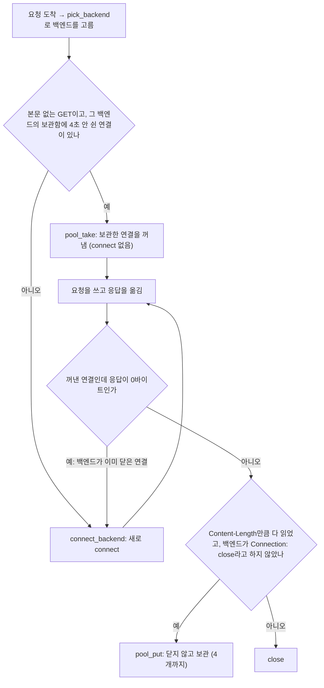

# 단계 19: 프록시와 백엔드 사이의 keep-alive (연결 보관함)

## 어떤 문제가 있었나

단계 15의 keep-alive는 클라이언트와 프록시 사이의 연결만 유지했다. 프록시 프로세스는 요청마다 백엔드에 새로 `connect`하고 응답 뒤에 `close`했다.
클라이언트가 연결 하나로 요청 100개를 보내도, 프록시와 백엔드 사이에서는 TCP 연결 맺기(패킷 세 개)와 백엔드의 `fork`가 100번 일어났다.

| | 단계 15 | 단계 19 |
|---|---|---|
| 클라이언트와 프록시 사이 | 유지 | 유지 |
| 프록시와 백엔드 사이 | 요청마다 `connect`, 응답 뒤 `close` | 응답 뒤 닫지 않고 보관했다가 다시 씀 |
| 프록시가 백엔드에 보내는 요청 | `HTTP/1.0`, `Connection: close` | `HTTP/1.1`, `Connection: keep-alive` |
| 프록시가 응답의 끝을 아는 방법 | 백엔드가 연결을 닫음 | `Content-Length`만큼 읽음 |

## 어떻게 풀었나

**핵심 한 문장:** 응답이 끝나면 백엔드와의 연결을 `close`하지 않고 그 백엔드의 보관함(connection pool)에 넣었다가, 다음 요청이 꺼내 쓴다.



그렇게 하면 문제가 네 개 생긴다. 코드의 각 부분은 그 문제의 답이다.

| 문제 | 답 | 코드 (`proxy/proxy.c`) |
|---|---|---|
| 1. 백엔드가 연결을 닫지 않으니 응답의 끝을 모른다 | `Content-Length`만큼만 읽는다. 다 읽으면 연결이 열려 있어도 응답은 끝났다 | `relay_response`의 `while (left > 0)` |
| 2. 여러 스레드가 보관함을 같이 쓴다 | `pool_lock`으로 꺼내기와 넣기를 감싼다. 꺼낸 연결은 보관함에서 빠지므로 한 스레드만 쓴다 | `pool_take`, `pool_put` |
| 3. 쉬는 동안 백엔드가 먼저 닫는다 (백엔드의 유휴 제한 시간 5초) | 4초 넘게 쉰 연결은 꺼낼 때 닫고 버린다. 그래도 닫힌 연결을 꺼냈으면(응답 0바이트) 새 연결로 한 번 다시 보낸다 | `pool_take`의 `POOL_IDLE_MS`, `proxy_request`의 `if (ex.sent > 0)` |
| 4. 요청이 몰린 뒤 쉬는 연결이 너무 많이 남는다 | 보관함은 백엔드마다 4개까지. 꽉 찼으면 넣지 않고 닫는다 | `pool_put`의 `POOL_MAX` |

## 중요한 개념

| 개념 | 코드 | 설명 |
|---|---|---|
| 연결 보관함 | `proxy/proxy.h`의 `struct backend`: `idle_fds`, `idle_since`, `idle_count` | 백엔드마다 따로 있다. 라운드로빈으로 백엔드를 먼저 고르고, 그 백엔드의 보관함만 본다. 그래서 라운드로빈의 순서는 바뀌지 않는다 |
| 꺼내면 빠진다 | `pool_take`의 `backend->idle_count--` | 보관함에 있는 동안은 아무도 쓰지 않는 연결이고, 꺼낸 뒤에는 꺼낸 스레드 혼자 쓴다. 두 스레드가 같은 연결에 요청을 쓰면 서로의 응답을 읽을 수 있다 |
| 잠금의 범위 | `pool_lock` | 배열을 읽고 쓰는 동안만 잡는다. 요청을 쓰고 응답을 읽는 동안, `close`와 `printf`를 하는 동안에는 잡지 않는다. `next_lock`, `cache_lock`과 별도이고 겹쳐 잡지 않는다 |
| 응답의 끝 | `relay_response` | `Content-Length`가 있으면 그 길이만큼, 없으면 백엔드가 닫을 때까지. 뒤의 경우는 연결을 다시 쓸 수 없다 |
| 다시 써도 되는 연결 | `relay_response`의 `*reusable` | `Content-Length`만큼 다 읽었고, 응답이 `HTTP/1.1`이고, 백엔드가 `Connection: close`라고 하지 않았을 때다. 우리 웹 서버의 에러 응답은 `Connection: close`라서 그 연결은 닫는다 |
| Connection 헤더는 구간마다 따로다 | `send_request`, `write_head` | Connection 헤더는 그 헤더가 지나가는 연결 하나에 대한 말이다. 클라이언트가 보낸 Connection 줄은 백엔드에 넘기지 않고, 백엔드가 보낸 Connection 줄도 클라이언트에게 넘기지 않는다. 구간마다 프록시가 새로 써 넣는다 |
| Host 헤더 | `send_request` | `HTTP/1.1` 요청에는 Host가 꼭 있어야 하고, 없으면 우리 웹 서버가 400으로 답한다. `HTTP/1.0` 클라이언트가 Host 없이 보낸 요청에는 프록시가 백엔드의 주소로 Host 줄을 넣는다 |
| 요청을 `write` 한 번으로 | `send_request`의 `out` 버퍼 | 유지된 연결에서 작은 `write`를 두 번 하고 응답을 기다리면 커널이 둘째 `write`를 붙잡아 응답이 약 40ms 늦어질 수 있다 (단계 15의 `TCP_NODELAY`와 같은 원인). 요청 줄과 헤더를 한 버퍼에 모아 한 번에 쓴다 |

## 내린 결정과 이유

| 결정 | 이유 |
|---|---|
| 보관함은 4개까지 (`POOL_MAX`) | 우리 백엔드는 연결마다 자식 프로세스를 `fork`한다. 쉬는 연결 하나는 백엔드의 쉬는 프로세스 하나다 |
| 4초 넘게 쉰 연결은 버린다 (`POOL_IDLE_MS`) | 백엔드가 5초 쉰 연결을 닫는다. 그보다 먼저 버리면 닫힌 연결을 꺼내는 일이 거의 없다 |
| 닫힌 연결이면 새 연결로 한 번 다시 보낸다 | 응답이 한 바이트도 오지 않았으면 클라이언트에게 아직 아무것도 쓰지 않았으므로, 다시 보내도 클라이언트는 차이를 모른다 |
| 보관한 연결은 본문 없는 GET에만 쓴다. POST는 늘 새로 `connect`한다 | 닫힌 연결에 보낸 요청을 백엔드가 받았는지 프록시는 알 수 없다. GET은 다시 보내도 되지만 POST는 두 번 처리될 수 있다. POST를 새 연결로만 보내면 다시 보낼 일이 생기지 않는다. POST가 쓴 연결도 응답 뒤에는 보관한다 |
| 다시 보낼 새 연결도 맺지 못하면 그 백엔드를 제외하고 다음 백엔드로 간다 | 단계 16의 failover와 같은 규칙이다. 502로 끝내면, 백엔드가 죽은 직후에 보관한 연결을 꺼낸 요청만 에러를 받게 된다 |
| 죽음으로 표시된 백엔드의 보관함은 비운다 | `mark_backend_dead`와 `check_backends`가 `pool_close_all`을 부른다 |
| Forward Proxy는 바꾸지 않는다 | 서버가 요청마다 달라서 보관할 곳이 없다. `HTTP/1.0`, `Connection: close`로 보내고 응답 뒤에 닫는다 |
| 캐시는 바꾸지 않는다 | hit이면 백엔드를 고르지도 않으므로 보관함을 쓰지 않는다 |

## 프록시의 출력

`/api/`는 백엔드가 둘(8001, 8003)이다. 네 번 요청하면 첫 두 번은 백엔드마다 새로 `connect`하고, 다음 두 번은 보관한 연결을 다시 쓴다.

```text
[Reverse] GET /api/ → 127.0.0.1:8001
[Pool] 127.0.0.1:8001 새로 connect
[Pool] 127.0.0.1:8001 연결을 닫지 않고 보관 (보관 중 1개)
응답 141바이트를 클라이언트에게 전달
[Reverse] GET /api/ → 127.0.0.1:8003
[Pool] 127.0.0.1:8003 새로 connect
[Pool] 127.0.0.1:8003 연결을 닫지 않고 보관 (보관 중 1개)
응답 141바이트를 클라이언트에게 전달
[Reverse] GET /api/ → 127.0.0.1:8001
[Pool] 127.0.0.1:8001 보관한 연결을 다시 씀 (connect 없음)
[Pool] 127.0.0.1:8001 연결을 닫지 않고 보관 (보관 중 1개)
응답 141바이트를 클라이언트에게 전달
[Reverse] GET /api/ → 127.0.0.1:8003
[Pool] 127.0.0.1:8003 보관한 연결을 다시 씀 (connect 없음)
[Pool] 127.0.0.1:8003 연결을 닫지 않고 보관 (보관 중 1개)
응답 141바이트를 클라이언트에게 전달
```

그 밖의 줄: `[Pool] ... 4초 넘게 쉰 연결 1개를 닫음`, `[Pool] ... 보관한 연결이 이미 닫혀 있음 → 새 연결로 다시 보냄`, `[Pool] ... 보관함이 꽉 차서(4개) 연결을 닫음`, `[Pool] ... 보관한 연결 N개를 닫음 (백엔드가 죽음으로 표시됨)`.

## 실행 방법

```bash
# 터미널 1, 2, 3: 백엔드 둘과 프록시
make
./build/server 8001 demo/proxy/backend1
./build/server 8003 demo/proxy/backend3
./build/proxy 8080 proxy.conf
```

```bash
# 터미널 4: 네 번 요청한다
for i in 1 2 3 4; do curl -s http://localhost:8080/api/ > /dev/null; done
```

백엔드 8001(터미널 1)의 출력에는 `이 연결의 2번째 요청`이 나온다. 5초 기다린 뒤 다시 요청하면 프록시의 출력에 `4초 넘게 쉰 연결 1개를 닫음`과 `새로 connect`가 나온다.
`/static/`은 `proxy.conf`에서 캐시 대상이라, 두 번째 요청부터는 백엔드에 가지 않는다 (보관함을 쓰지 않는다).

## 테스트

```bash
make test    # "백엔드와의 연결을 다시 쓰기" 줄들과 pool_take, pool_put 줄들
make asan
```

- `tests/test_proxy.c`: 보관함의 꺼내기와 넣기, 나중에 넣은 것부터, 4초 경계, 4개 제한, `mark_backend_dead`가 비우는지. 시계는 `pool_clock`을 가짜 시계로 바꿔 기다리지 않는다
- `tests/run_proxy_tests.sh`: GET 두 번이 연결을 다시 쓰는지, 백엔드가 연결 하나에서 요청을 세 번 받는지, POST는 새로 `connect`하는지, 백엔드가 닫은 연결을 꺼내도 200인지, 4초 넘게 쉰 뒤에는 새로 `connect`하는지
- 프록시 실행 파일과 단위 테스트를 `-fsanitize=thread`로 빌드해 같은 스크립트를 돌렸고 데이터 레이스 경고가 없었다

## 한계

- 백엔드가 `SIGTERM`을 받으면 새 연결은 받지 않지만, 이미 맡은 연결의 자식 프로세스는 끝날 때까지(최대 5초) 남는다. 그동안 프록시가 보관한 연결로 보낸 요청은 그 백엔드가 처리한다. 헬스 체크가 죽음으로 표시하면(최대 2초) 보관함을 비운다.
- 보관한 연결이 닫혔는지는 요청을 보내 봐야 안다. 꺼낼 때 미리 검사하지 않는다.
- 백엔드가 응답을 chunked로 보내는 경우(`Transfer-Encoding: chunked`)는 다루지 않는다. 우리 웹 서버는 항상 `Content-Length`를 붙인다.
- POST는 요청마다 새로 `connect`한다.
