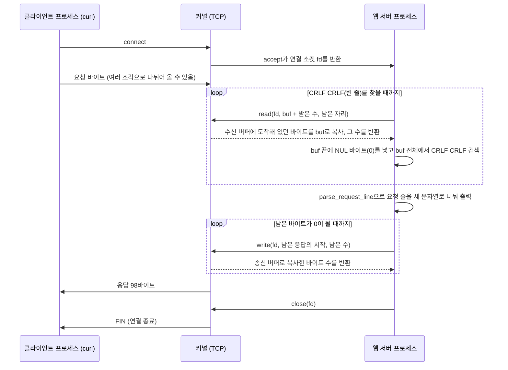
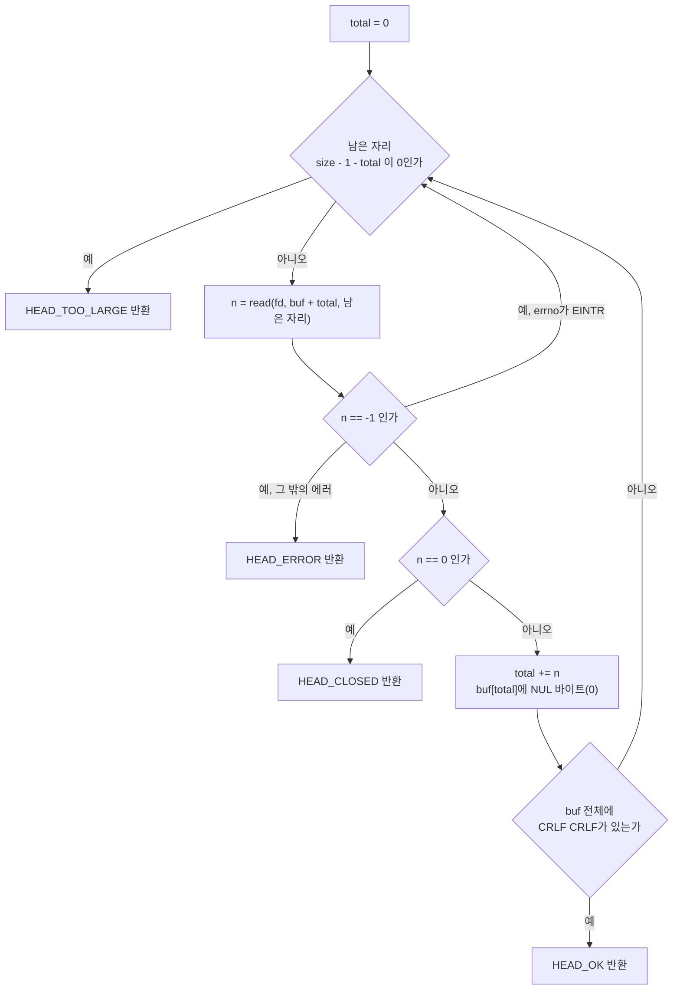

# 단계 3. 빈 줄까지 헤더를 읽고 고정 응답 보내기

## 무엇을 만들었나

웹 서버 프로세스가 연결 하나를 받은 뒤 하는 일을 두 가지 바꿨다.

1. 요청을 `read` 한 번이 아니라, 헤더의 끝 표시 `\r\n\r\n`(빈 줄)이 나올 때까지 `read`를 반복해서 받는다.
2. 요청을 받은 뒤 그냥 닫지 않고, 고정 응답(`200 OK`와 `<h1>Hello</h1>`) 98바이트를 보낸 뒤 닫는다.

| 파일 | 내용 |
|---|---|
| `include/http.h`, `src/http.c` | `read_request_head` 추가 (빈 줄까지 `read` 반복) |
| `include/net.h`, `src/net.c` | `write_all` 추가 (다 쓸 때까지 `write` 반복) |
| `src/main.c` | `read` 한 번을 `read_request_head`로 바꿈, 고정 응답 `RESPONSE`를 `write_all`로 보냄, 헤더가 버퍼보다 길면 `RESPONSE_431`을 보냄, 버퍼 4096 → 8192바이트 |
| `tests/test_http.c`, `tests/test_net.c` | 단위 테스트 27개 추가 (19 + 8) |
| `tests/run_tests.sh` | 요청을 두 조각으로 나눠 보내고 응답 98바이트를 비교, 아무것도 안 보내고 닫는 경우와 버퍼보다 긴 헤더를 보내는 경우 추가 |

요청 내용에 따라 응답을 바꾸는 것은 아직 없다. 어떤 요청이 와도 같은 응답을 보낸다.

## 전체 흐름

그림에서 CRLF CRLF는 `\r\n\r\n` 4바이트(빈 줄), NUL 바이트는 `'\0'`을 뜻한다.



## 실행 결과

터미널 A에서 웹 서버 프로세스를 띄우고, 터미널 B에서 `curl -i http://localhost:8080/`을 실행한 결과다(컨테이너에서 실측). `-i`는 응답의 상태 줄과 헤더도 출력하라는 옵션이다.

터미널 B (클라이언트 프로세스의 출력):

```
HTTP/1.1 200 OK
Content-Type: text/html
Content-Length: 15
Connection: close

<h1>Hello</h1>
```

터미널 A (웹 서버 프로세스의 출력):

```
socket fd = 3
bind 성공: 0.0.0.0:8080
listen 중: 연결을 기다립니다 (다른 터미널에서 curl localhost:8080)
연결 수락: 클라이언트 127.0.0.1:50778 (conn fd = 4)
받은 바이트 수: 77
메서드: GET
요청 대상: /
HTTP 버전: HTTP/1.1
응답을 보냈습니다 (98바이트)
연결을 닫았습니다 (conn fd = 4)
```

단계 2까지는 `curl`이 `(52) Empty reply from server`를 출력했다. 이번 단계부터는 응답을 받으므로 `curl`의 종료 코드가 0이다.

## 중요하다고 본 개념

### 왜 `read`를 반복해야 하나

TCP는 메시지 경계가 없는 바이트 스트림이다. 클라이언트 프로세스가 요청을 `write` 한 번으로 보내도, 웹 서버 프로세스의 `read`는 그것을 여러 번에 나눠 받을 수 있다. `read`는 "지금 커널의 수신 버퍼에 도착해 있는 만큼"만 복사하고 돌아오기 때문이다. 그래서 요청이 끝났는지는 `read`의 횟수가 아니라 받은 바이트의 내용으로 판단해야 하고, 그 표시가 `\r\n\r\n`이다.

### `read_request_head`의 반복 (`src/http.c` 113~151줄)



- **이어 붙이는 위치**: `read`의 두 번째 인자가 `buf`가 아니라 `buf + total`이다. 이미 받은 바이트 바로 뒤부터 채운다는 뜻이다. `buf`로 주면 앞에서 받은 바이트를 덮어쓴다.
- **남은 자리**: `size - 1 - total`이다. 전체 크기에서 `'\0'` 자리 하나와 이미 받은 수를 뺀다.
- **검색 범위**: 이번에 받은 조각이 아니라 `buf` 전체에서 찾는다. `\r\n\r\n` 4바이트가 두 번의 `read` 사이에서 잘려 올 수 있기 때문이다. 예를 들어 앞 조각이 `...\r\n\r`로 끝나고 뒤 조각이 `\n`이면, 어느 조각에도 `\r\n\r\n`은 없다.
- **`'\0'`**: `strstr`은 `'\0'`을 만날 때까지 읽으므로, 받을 때마다 `buf[total] = '\0'`을 넣는다.

### 반환값 네 가지와 `main.c`의 처리 (`src/main.c` 98~143줄)

| 반환값 | 뜻 | `main.c`가 하는 일 |
|---|---|---|
| `HEAD_OK` (0) | `\r\n\r\n`을 찾았다 | 요청 줄을 나눠 출력하고 응답을 보낸 뒤 `close` |
| `HEAD_CLOSED` (1) | 헤더가 끝나기 전에 `read`가 0을 반환했다. 클라이언트 프로세스가 연결을 닫았다 | 응답 없이 `close` (받을 상대가 없다) |
| `HEAD_TOO_LARGE` (2) | 버퍼가 가득 찼는데 `\r\n\r\n`이 없다 | 요청을 해석하지 않고 431 응답을 보낸 뒤 `close` |
| `HEAD_ERROR` (-1) | `read`가 에러로 실패했다 | 소켓을 닫고 종료 코드 1 |

`read`가 0을 돌려주는 것은 "성공"이 아니라 "상대가 닫았다(EOF)"는 뜻이다. `EINTR`은 `read`가 기다리는 중에 시그널이 와서 중단됐다는 뜻이고, 받은 것이 없으니 같은 인자로 다시 `read`한다.

### HTTP 응답의 구조와 고정 응답 98바이트 (`src/main.c` 29~35줄)

응답도 요청과 같은 네 부분 구조다. 첫 줄이 요청 줄 대신 상태 줄이다.

RFC 9112 4절:

```
status-line = HTTP-version SP status-code SP [ reason-phrase ]
```

번역: 상태 줄 = HTTP 버전, 공백, 상태 코드, 공백, 설명 문구(없어도 됨).

| 부분 | 바이트 | 내용 |
|---|---|---|
| 상태 줄 | 17 | `HTTP/1.1 200 OK\r\n` |
| 헤더 줄 | 25 | `Content-Type: text/html\r\n` 본문이 HTML 문서라는 뜻 |
| 헤더 줄 | 20 | `Content-Length: 15\r\n` 본문이 15바이트라는 뜻 |
| 헤더 줄 | 19 | `Connection: close\r\n` 이 응답 뒤에 연결을 닫는다는 뜻 |
| 빈 줄 | 2 | `\r\n` 헤더의 끝 |
| 본문 | 15 | `<h1>Hello</h1>\n` |
| 합계 | 98 | |

- `Content-Length`의 값은 본문의 바이트 수와 정확히 같아야 한다. 클라이언트 프로세스는 이 숫자만큼만 본문으로 읽는다.
- `Connection: close`를 넣는 근거는 RFC 9112 9.6절이다.

```
A server that does not support persistent connections MUST send the "close" connection option in every response message that does not have a 1xx (Informational) status code.
```

번역: 지속 연결을 지원하지 않는 서버는 1xx(정보) 상태 코드가 아닌 모든 응답 메시지에 "close" 연결 옵션을 반드시 보내야 한다.

- `main.c`는 길이를 `sizeof(RESPONSE) - 1`로 구한다. `sizeof`는 문자열 상수 끝의 `'\0'`까지 세는데, `'\0'`은 HTTP 메시지의 일부가 아니라서 1을 뺀다.

### 왜 `write`도 반복하나 (`src/net.c` 149~172줄)

`write`는 프로세스의 바이트를 커널의 송신 버퍼로 복사하고, 복사한 바이트 수를 돌려준다. `write`는 요청한 것보다 적게 쓰고 돌아올 수 있다(부분 쓰기). 블로킹 소켓에서는 송신 버퍼에 자리가 모자라도 `write`가 자리가 날 때까지 기다렸다가 전부 쓰므로, 부분 쓰기는 `write`가 기다리는 도중에 시그널이 도착했을 때(이미 쓴 바이트 수만 돌려준다)나 소켓을 논블로킹으로 설정했을 때 일어난다. `write_all`은 돌려받은 수만큼 시작 위치를 앞으로 옮기고(`buf += n`), 남은 수를 줄이며(`left -= n`), 남은 수가 0이 될 때까지 다시 `write`한다. 지금 웹 서버 프로세스는 시그널 핸들러를 설치하지 않고 블로킹 소켓을 쓰므로 이 반복은 실제로는 한 번만 돈다. 컨테이너(리눅스 6.18)에서 4MB를 `write` 한 번으로 썼을 때 시그널이 없으면 4,194,304바이트가 전부 쓰였고, 쓰는 도중 시그널이 도착하면 3,919,872바이트만 쓰이고 돌아왔다. 동시성 단계에서 시그널이나 논블로킹 소켓을 쓰게 되면 이 반복이 실제로 필요해진다.

## 결정사항과 이유

네 가지 모두 소망이 선택지를 비교한 뒤 정했다(2026-11-23). ①②③은 추천안을 그대로 골랐고, ④는 추천안(응답 없이 `close`) 대신 에러 응답을 보내는 쪽을 골랐다.

| 번호 | 결정할 것 | 결정 | 고르지 않은 선택지 | 이유 |
|---|---|---|---|---|
| ① | 읽는 방식 | 한 버퍼에 이어 붙이고 `\r\n\r\n` 검색 | CSAPP `rio_readlineb` 방식으로 한 줄씩 읽기 | 단계 2의 `parse_request_line(buf, ...)`을 그대로 쓸 수 있다. 한 줄씩 읽으려면 남은 바이트를 보관하는 내부 버퍼를 새로 만들어야 한다 |
| ② | 헤더 버퍼 크기 | 8192바이트 | 4096바이트 | RFC 9112 3절이 요청 줄 길이를 최소 8000옥텟까지 지원하도록 권장한다 |
| ③ | `write` 반복 함수 | 이번 단계에 넣음 | 단계 4에서 넣음 | 응답을 처음 보내는 단계에서 `read` 반복과 함께 익힌다 |
| ④ | 헤더가 버퍼보다 길 때 | 431 응답을 보냄 | 응답 없이 `close` | 클라이언트 프로세스가 연결이 끊긴 이유를 알 수 있다. 400과 431 중에서는 원인을 더 정확히 말하는 431로 구현했다 |

431의 정의, RFC 6585 5절:

```
The 431 status code indicates that the server is unwilling to process the request because its header fields are too large.
```

번역: 431 상태 코드는 요청의 헤더 필드가 너무 커서 서버가 그 요청을 처리하지 않겠다는 것을 나타낸다.

431 응답은 157바이트다. 상태 줄 `HTTP/1.1 431 Request Header Fields Too Large`, 고정 응답과 같은 헤더 세 줄(`Content-Length`는 45), 빈 줄, 본문 `<h1>431 Request Header Fields Too Large</h1>`(45바이트)로 이루어진다(`src/main.c`의 `RESPONSE_431`).

버퍼 크기의 근거인 RFC 9112 3절:

```
It is RECOMMENDED that all HTTP senders and recipients support, at a minimum, request-line lengths of 8000 octets.
```

번역: 모든 HTTP 송신자와 수신자는 최소한 8000옥텟 길이의 요청 줄을 지원하는 것이 권장된다.

## 확인한 것

| 확인 | 결과 |
|---|---|
| `make` | 경고 없음 |
| `make test` | PASS 72줄 (서버 5 + `test_net` 23 + `test_http` 44), 실패 0. 다섯 번 연속 실행해 모두 같음 |
| `make asan` | PASS 72줄, 메모리 오류와 누수 보고 없음 |
| `curl -i http://localhost:8080/` | `HTTP/1.1 200 OK`, 헤더 세 줄, `<h1>Hello</h1>`, `curl` 종료 코드 0 |
| 요청을 `\r\n\r\n` 한가운데에서 두 조각으로 나눠 보냄 | 웹 서버 프로세스가 50바이트를 이어 받아 응답 98바이트를 보냄 (`run_tests.sh` 서버 실행 1) |
| 아무것도 보내지 않고 닫음 | 응답 없이 종료 코드 0 (`run_tests.sh` 서버 실행 2) |
| 값이 9000바이트인 헤더를 `curl -H`로 보냄 | 여섯 번 모두 `curl`이 431 응답 157바이트를 받고 종료 코드 0 (`run_tests.sh` 서버 실행 3) |
| 금지 라이브러리 이름 검색 | 0건 |

단위 테스트는 `socketpair`로 서로 연결된 소켓 두 개를 만들고, `fork`로 만든 자식 프로세스가 클라이언트 역할을 해서 조각을 0.05초 간격으로 보낸다. 세 조각으로 나뉜 요청, 헤더 도중에 닫힘, 버퍼보다 긴 헤더, 버퍼에 꼭 맞는 헤더, 4MB를 `write_all`로 보내기를 확인한다.

## 아직 하지 않은 것 (알고 있는 한계)

- 연결을 하나만 받고 프로그램이 끝난다. 연결을 계속 받는 반복은 없다.
- 요청 내용과 상관없이 같은 응답을 보낸다. 요청 줄 형식이 틀려도 200을 보낸다. 요청 대상에 따라 파일을 보내는 것은 단계 4, 400·405 같은 에러 응답은 단계 5다.
- 헤더가 8191바이트보다 길면 431을 보낸다. 요청 줄 하나가 너무 긴 경우(RFC가 414 URI Too Long을 쓰라고 한 경우)도 구분하지 않고 431을 보낸다.
- 431을 보낼 때 웹 서버 프로세스는 요청의 뒷부분을 읽지 않은 채 `close`한다. 읽지 않은 바이트가 수신 버퍼에 남은 채 닫으면 커널이 RST를 보내고, 그 RST가 응답보다 먼저 처리되면 클라이언트 프로세스가 431을 받지 못할 수 있다. 같은 컴퓨터 안(루프백)의 여섯 번 실측에서는 매번 응답이 도착했지만, 다른 컴퓨터에서 접속할 때는 확인하지 못했다.
- `EINTR` 처리와 `write`의 실제 에러 경로는 코드에 있지만 테스트로 일으켜 보지 못했다.
- 클라이언트 프로세스가 응답을 받기 전에 연결을 닫으면, 웹 서버 프로세스의 `write`가 `SIGPIPE` 시그널을 받아 프로세스가 종료될 수 있다. 이 처리는 하지 않았다.
- 클라이언트 프로세스가 헤더 뒤에 본문을 보냈는데 웹 서버 프로세스가 그것을 읽지 않고 `close`하면, 커널이 FIN 대신 RST를 보낼 수 있다(단계 1-3에서 관찰한 것과 같은 현상). GET 요청에는 보통 본문이 없어서 지금은 드러나지 않는다.
- 클라이언트 프로세스가 헤더를 끝내지 않고 연결만 열어 두면 웹 서버 프로세스는 `read`에서 계속 기다린다. 시간 제한은 없다.
