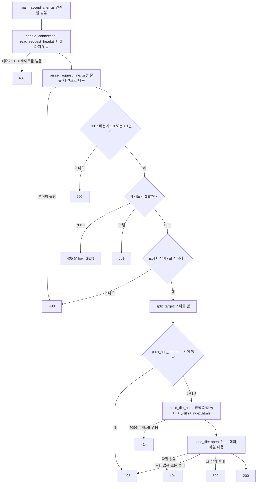

# 단계 4·5: 정적 파일 서버 (덩어리 1)

로드맵 단계 4(정적 파일, 404, `accept` 반복, 명령행 인자)와 단계 5(MIME 타입, 오류 응답, `../` 차단)를 한 번에 구현한 기록이다.

## 무엇을 만들었나

`./build/server 8080 ./www`로 실행하면, 웹 서버 프로세스가 요청 대상에 맞는 파일을 `./www` 폴더에서 찾아 보낸다. 브라우저로 `http://localhost:8080/`을 열면 HTML, CSS, JS, PNG, JPG가 모두 표시된다.

| 파일 | 역할 |
|---|---|
| `src/main.c` | 명령행 인자(포트, 정적 파일 폴더)를 읽고, 소켓을 준비하고, `accept` → `handle_connection` → `close`를 반복한다 |
| `src/handler.c` | `handle_connection`: 연결 하나의 요청을 읽고, 검사하고, 응답을 고른다 |
| `src/response.c` | `send_file`(파일을 200으로 보냄), `send_error`(오류 응답), `mime_type`(확장자 → Content-Type), `status_text`(상태 코드 → 문구) |
| `src/http.c` | 요청 읽기와 해석. 이번에 `split_target`(쿼리 문자열 떼기), `path_has_dotdot`(`..` 칸 찾기)을 더했다 |
| `www/` | 예제 정적 파일 (`index.html`, `style.css`, `app.js`, `img/red.png`, `img/blue.jpg`) |

## 요청 하나를 처리하는 순서

## 상태 코드 표

| 코드 | 언제 보내나 | 보내는 곳 |
|---|---|---|
| 200 OK | 파일을 찾아서 보냄 | `send_file` |
| 400 Bad Request | 요청 줄이 세 칸이 아님, 요청 대상이 `/`로 시작하지 않음 | `handle_connection`, `respond` |
| 403 Forbidden | 경로에 `..` 칸이 있음, 파일을 읽을 권한이 없음, 폴더를 요청함 | `respond`, `send_file` |
| 404 Not Found | 파일이 없음 | `send_file` |
| 405 Method Not Allowed | 정적 파일에 POST를 보냄 (`Allow: GET` 헤더 포함) | `respond` |
| 414 URI Too Long | 만든 파일 경로가 4096바이트를 넘음 | `respond` |
| 431 Request Header Fields Too Large | 요청 줄과 헤더가 8191바이트를 넘음 | `handle_connection` |
| 500 Internal Server Error | `open`, `fstat`이 위에 없는 이유로 실패 | `send_file` |
| 501 Not Implemented | GET, POST가 아닌 메서드 | `respond` |
| 505 HTTP Version Not Supported | 버전이 HTTP/1.0, HTTP/1.1이 아님 | `respond` |

## 중요하다고 본 개념

**`open`과 `errno`.** `open(path, O_RDONLY)`는 파일을 읽기 전용으로 열고 새 fd를 돌려준다. 실패하면 -1을 돌려주고 이유를 `errno`에 넣는다. `ENOENT`(파일 없음)는 404, `EACCES`(권한 없음)는 403으로 바꿔 보낸다.

**`fstat`과 `Content-Length`.** `fstat(fd, &st)`는 열린 파일의 정보를 채워 준다. `st.st_size`가 파일 크기(바이트)이고, 이 값을 `Content-Length` 헤더에 적는다. 클라이언트 프로세스는 이 숫자만큼 본문을 받으면 응답이 끝났다고 판단한다.

**파일 내용은 문자열이 아니라 바이트다.** PNG, JPG에는 값이 0인 바이트가 들어 있다. `strlen`은 0을 만나면 멈추므로 쓸 수 없다. `read`가 돌려준 바이트 수 `n`만큼만 `write`한다. 파일 전체를 메모리에 올리지 않고 8192바이트씩 읽어 바로 보내는 일을 `read`가 0(파일 끝)을 돌려줄 때까지 반복한다.

**MIME 타입.** `Content-Type` 헤더의 값이다. 브라우저는 파일 이름이 아니라 이 값을 보고 내용을 HTML로 그릴지, CSS로 적용할지, 이미지로 보여 줄지 정한다. 서버는 확장자를 표에서 찾아 값을 정한다(`mime_type`).

**경로 순회(`../`) 차단.** `..`은 "한 단계 위 폴더"다. `/../Makefile`을 그대로 붙이면 `./www/../Makefile`이 되어 정적 파일 폴더 밖의 파일이 열린다. 경로를 `/`로 나눈 칸 중에 `..`이 있으면 403으로 거절한다.

**명령행 인자.** 셸이 명령 줄을 공백으로 나눠 `main(int argc, char *argv[])`에 넘긴다. `./build/server 8080 ./www`이면 `argc`는 3, `argv[1]`은 `"8080"`, `argv[2]`는 `"./www"`다. 포트는 문자열이므로 `strtol`로 숫자로 바꾼다.

## 결정사항과 이유

| 결정 | 선택 | 이유 |
|---|---|---|
| 명령행 인자 형식 | `./server [포트] [폴더]`, 생략하면 8080과 `./www` | 로드맵의 완료 기준(`./server 8080 ./www`)과 같다. 옵션 이름(`-p`)을 쓰는 방식은 설정 입력 방식을 정할 때 다시 본다 |
| 폴더를 요청했을 때(`/img`) | 403 | 폴더 목록을 보여 주는 기능이 없다. `/img/`처럼 `/`로 끝나면 `index.html`을 찾고 없으면 404다 |
| `..` 처리 | 칸이 `..`이면 무조건 403 | 경로를 정리해서 폴더 안인지 계산하는 방법보다 단순하고 설명하기 쉽다. `/a/../b`처럼 실제로는 폴더 안인 경로도 거절된다 |
| POST | 405, 그 밖의 메서드는 501 | POST는 단계 7·8에서 동적 요청에 쓴다. 정적 파일에는 허용하지 않는다 |
| 응답의 `Connection` | 항상 `close` | 연결을 계속 쓰는 기능(keep-alive)은 아직 정하지 않았다 |
| 글자 파일의 `Content-Type` | `; charset=utf-8`을 붙임 | 브라우저가 한글을 깨지지 않게 보여 준다 |
| `write` | 한 번 호출하고 -1만 확인 | 단계 3의 결정과 같다. 블로킹 소켓에서는 요청한 바이트를 모두 쓴 뒤 돌아온다 |

상태 코드의 RFC 절 번호는 기억에 의존해 적었고 원문은 대조하지 않았다.

## 확인한 것

| 확인 | 결과 |
|---|---|
| `make` | 경고 없음 |
| `make test` | PASS 134줄, 실패 0. 세 번 연속 실행해 모두 같음 |
| `make asan` | PASS 134줄, 메모리 오류 보고 없음 |
| `curl`로 HTML, CSS, JS, PNG, JPG, 1MiB 파일 | 상태 코드 200, `Content-Type`이 기대와 같고, 받은 내용이 파일과 한 바이트도 다르지 않음(`cmp`) |

브라우저로 여는 확인은 컨테이너에서 하지 못했다. 로컬에서 직접 확인해야 한다. "읽을 권한이 없는 파일 → 403" 검사는 컨테이너가 root로 실행되어 건너뛰었다(root는 권한 검사를 받지 않는다). 일반 사용자로 `make test`를 실행하면 이 검사도 실행된다.

## 아직 하지 않은 것 (알고 있는 한계)

- 한 번에 연결 하나만 처리한다. 동시성 모델은 정하지 않았다.
- 클라이언트 프로세스가 응답을 받는 도중 연결을 닫으면, 웹 서버 프로세스가 `SIGPIPE` 시그널로 끝날 수 있다. 브라우저에서 새로 고침을 빠르게 반복하면 생길 수 있다. 로드맵 단계 10에서 다룬다.
- `%20` 같은 퍼센트 인코딩을 풀지 않는다. 이름에 공백이나 한글이 있는 파일은 찾지 못한다.
- 심볼릭 링크가 정적 파일 폴더 밖을 가리키면 그 파일이 열린다.
- 헤더(`Host` 등)를 해석하지 않는다. 단계 6에서 한다.
- `read` 타임아웃이 없다. 연결만 하고 아무것도 보내지 않는 클라이언트가 있으면 다른 연결을 받지 못한다.
