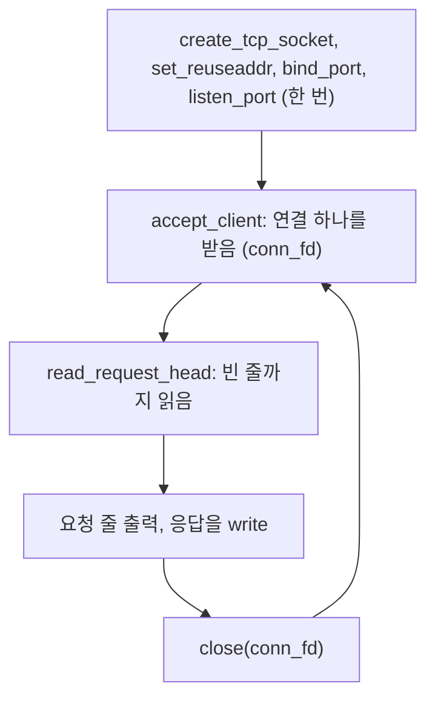

# 단계 4: 요청 대상에 맞는 파일 보내기

단계 4는 여섯 조각으로 나눠 진행한다. 이 문서는 조각이 끝날 때마다 이어 쓴다.

| 조각 | 내용 | 상태 |
|---|---|---|
| 1 | `accept`부터 `close(conn_fd)`까지 반복하기 | 완료 |
| 2 | 요청 대상을 파일 경로로 바꾸기 | 아직 |
| 3 | 파일 열기, 없으면 404 | 아직 |
| 4 | `fstat`으로 응답 헤더 만들기 | 아직 |
| 5 | 파일 내용 보내기 | 아직 |
| 6 | 명령행 인자 | 아직 |

## 조각 1: `accept`부터 `close(conn_fd)`까지 반복하기

### 무엇이 문제였나

단계 3의 웹 서버 프로세스는 연결 하나를 처리하고 `main`이 끝났다. `curl`을 한 번 실행하면 응답을 받지만, 두 번째로 실행하면 웹 서버 프로세스가 이미 끝나 있어서 연결할 수 없었다.

### 무엇을 만들었나

`src/main.c`에서 연결 하나를 처리하는 부분(`accept_client` → `read_request_head` → `parse_request_line` → `write` → `close(conn_fd)`)을 `for (;;)` 반복문(96줄부터) 안에 넣었다. `create_tcp_socket`, `set_reuseaddr`, `bind_port`, `listen_port`는 반복문 앞에 그대로 두어 프로세스가 시작할 때 한 번만 실행한다.



바뀐 점은 세 가지다.

| 바뀐 것 | 단계 3 | 조각 1 |
|---|---|---|
| 연결 처리 | 한 번 하고 `main`이 끝남 | `for (;;)` 안에서 끝없이 반복 |
| 연결 하나에서 오류가 났을 때 (`accept_client`, `read_request_head`, `write`, `close(conn_fd)` 실패) | 듣기 소켓까지 닫고 `return 1`로 프로세스 종료 | 그 연결만 닫고 `continue`로 다음 `accept_client`로 감 |
| 프로세스 종료 | `close(fd)` 뒤 `return 0` | 터미널에서 Ctrl+C. 반복을 빠져나오는 코드가 없어서 `close(fd)`와 `return 0`은 지웠다 |

`socket`, `bind`, `listen`이 실패하면 지금도 프로세스를 끝낸다. 듣기 소켓이 없으면 연결을 하나도 받을 수 없기 때문이다.

### 실행 결과

터미널 A에서 `./build/server`를 띄우고 터미널 B에서 `curl -i http://localhost:8080/`을 세 번 실행했다(컨테이너에서 실측). 세 번 모두 `HTTP/1.1 200 OK`를 받았고, 웹 서버 프로세스의 출력은 아래와 같다.

```
socket fd = 3
bind 성공: 0.0.0.0:8080
listen 중: 연결을 기다립니다 (다른 터미널에서 curl localhost:8080, 끝내려면 Ctrl+C)
연결 수락: 클라이언트 127.0.0.1:58180 (conn fd = 4)
받은 바이트 수: 77
메서드: GET
요청 대상: /
HTTP 버전: HTTP/1.1
응답을 보냈습니다 (98바이트)
연결을 닫았습니다 (conn fd = 4)
연결 수락: 클라이언트 127.0.0.1:58182 (conn fd = 4)
(같은 일곱 줄이 연결마다 되풀이된다)
```

### 중요하다고 본 개념

**듣기 소켓과 연결 소켓의 수명이 다르다.** 듣기 소켓(`fd`, 3번)은 프로세스가 사는 동안 계속 열려 있고, 연결 소켓(`conn_fd`)은 연결마다 `accept`가 새로 만들고 `close`가 없앤다.

**`conn_fd` 번호가 매번 4인 이유.** 커널은 새 fd를 줄 때 fd 테이블에서 비어 있는 가장 작은 번호를 고른다. 0, 1, 2는 표준 입력·출력·에러, 3은 듣기 소켓이 쓰고 있어서 첫 연결은 4번을 받는다. 그 연결을 `close(conn_fd)`로 닫으면 4번 칸이 비고, 다음 `accept`가 다시 4번을 받는다.

**`close(conn_fd)`를 빼면 번호가 늘어난다.** `close(conn_fd)`를 지운 실험용 사본으로 `curl`을 세 번 실행했더니 `conn fd`가 4, 5, 6으로 늘어났다(컨테이너에서 실측). 닫지 않은 연결 소켓이 fd 테이블에 계속 남기 때문이다. 이것이 fd 누수다. 프로세스 하나가 열 수 있는 fd 수에는 상한이 있어서, 계속 늘어나면 `accept`가 실패하게 된다.

**한 번에 연결 하나만 처리한다.** 웹 서버 프로세스가 어떤 연결의 `read_request_head`에서 기다리는 동안에는 `accept_client`를 호출하지 못한다. 그동안 들어온 다른 연결은 커널의 대기열에서 기다린다. 여러 연결을 동시에 처리하는 것은 동시성 단계의 일이다.

**`setvbuf(stdout, NULL, _IOLBF, 0)` (58줄).** 표준 출력이 터미널이 아니라 파일이면 C 라이브러리는 출력을 모아 두었다가 한꺼번에 내보낸다. 이 프로세스는 Ctrl+C로 끝나므로, 모아 둔 출력이 나가지 못하고 사라질 수 있다. 줄바꿈 문자를 만날 때마다 내보내도록 설정해서, `./build/server > 파일`로 실행해도 출력이 줄 단위로 파일에 남게 했다. 테스트 스크립트가 이 방식으로 출력을 검사한다.

### 결정사항과 이유

| 결정할 것 | 결정 | 이유 |
|---|---|---|
| 반복을 끝내는 방법 | 넣지 않음. Ctrl+C로 종료 | 시그널 처리는 뒤 단계의 일이다. 프로세스가 끝나면 커널이 열려 있던 fd를 모두 닫는다 |
| 반복문 뒤의 `close(fd)` | 지움 | 끝없는 반복 뒤에 있는 코드는 실행되지 않는다. 실행되지 않는 코드는 두지 않는다 |
| 연결 하나의 오류 처리 | 그 연결만 닫고 다음 연결로 | 클라이언트 하나의 문제로 웹 서버 프로세스 전체가 끝나면 안 된다 |

### 확인한 것

| 확인 | 결과 |
|---|---|
| `make` | 경고 없음 |
| `make test` | PASS 68줄 (서버 9 + `test_net` 15 + `test_http` 44), 실패 0. 다섯 번 연속 실행해 모두 같음 |
| `make asan` | PASS 68줄, 메모리 오류 보고 없음 |
| `curl -i http://localhost:8080/` 세 번 연속 | 세 번 모두 200 응답, 웹 서버 프로세스는 계속 실행 |

`tests/run_tests.sh`는 서버를 한 번만 띄우고 연결을 다섯 번 건다. 두 조각으로 나눈 요청, 두 번째 요청, 아무것도 보내지 않고 닫기, 버퍼보다 긴 헤더(431), 그 뒤의 요청 순서다. 다섯 연결 뒤에도 서버 프로세스가 실행 중인지, `conn fd` 번호가 한 종류인지 확인한다.

### 아직 하지 않은 것 (알고 있는 한계)

- 요청 대상이 무엇이든 같은 고정 응답을 보낸다. 조각 2부터 바꾼다.
- 한 번에 연결 하나만 처리한다. 클라이언트 프로세스가 연결만 하고 아무것도 보내지 않으면, 웹 서버 프로세스는 그 연결의 `read`에서 계속 기다리고 다른 연결을 받지 못한다.
- 클라이언트 프로세스가 응답을 받기 전에 연결을 닫으면, 웹 서버 프로세스의 `write`가 `SIGPIPE` 시그널을 받아 프로세스가 끝날 수 있다. 단계 3에도 있던 한계인데, 이제 서버가 계속 실행되므로 영향이 더 크다.
- `accept_client`가 계속 실패하는 상황(예: fd 상한에 도달)에서는 반복이 쉬지 않고 돈다.
- `continue`로 가는 오류 경로 네 곳과 `make asan`의 누수 검사(프로세스를 `kill`로 끝내면 종료 시 검사가 실행되지 않음)는 테스트로 확인하지 못했다.
