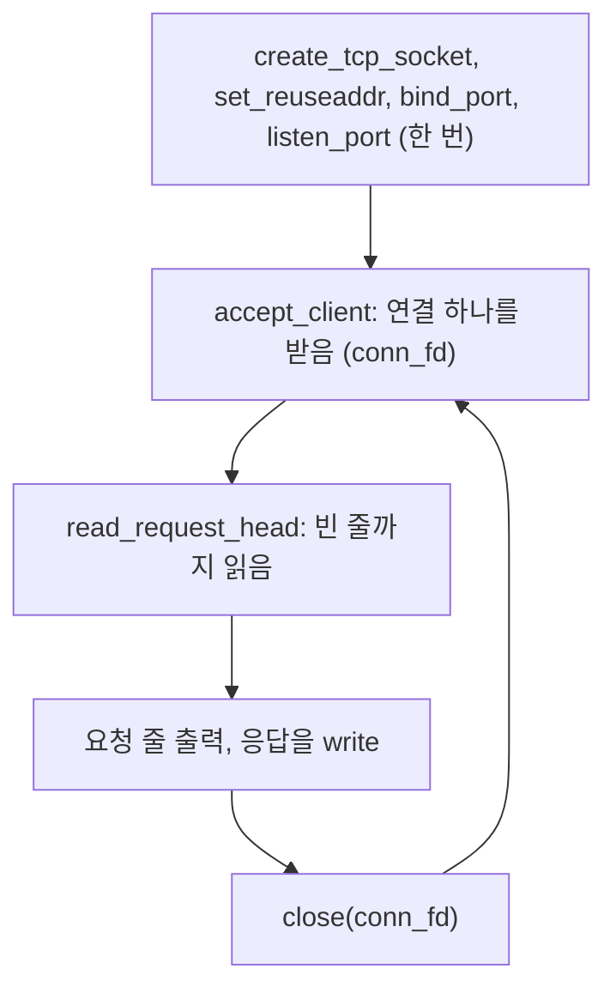
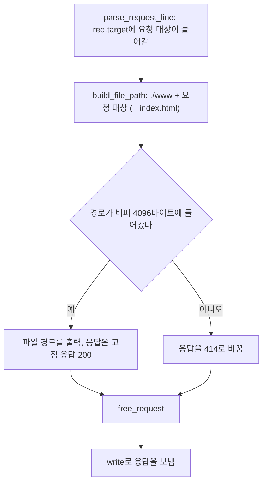

# 단계 4: 요청 대상에 맞는 파일 보내기

단계 4는 여섯 조각으로 나눠 진행하다가, 조각 2까지 만든 뒤 진행 방식을 바꿨다(11/23). 조각 3~6과 단계 5는 한 번에 구현했고 `docs/step4-5.md`에 정리했다. 아래 조각 1, 2의 기록은 그때의 코드 기준이라 줄 번호와 출력 문구가 지금 코드와 다르다.

| 조각 | 내용 | 상태 |
|---|---|---|
| 1 | `accept`부터 `close(conn_fd)`까지 반복하기 | 완료 |
| 2 | 요청 대상을 파일 경로로 바꾸기 | 완료 |
| 3 | 파일 열기, 없으면 404 | 완료 (`step4-5.md`) |
| 4 | `fstat`으로 응답 헤더 만들기 | 완료 (`step4-5.md`) |
| 5 | 파일 내용 보내기 | 완료 (`step4-5.md`) |
| 6 | 명령행 인자 | 완료 (`step4-5.md`) |

## 조각 1: `accept`부터 `close(conn_fd)`까지 반복하기

### 무엇이 문제였나

단계 3의 웹 서버 프로세스는 연결 하나를 처리하고 `main`이 끝났다. `curl`을 한 번 실행하면 응답을 받지만, 두 번째로 실행하면 웹 서버 프로세스가 이미 끝나 있어서 연결할 수 없었다.

### 무엇을 만들었나

`src/main.c`에서 연결 하나를 처리하는 부분(`accept_client` → `read_request_head` → `parse_request_line` → `write` → `close(conn_fd)`)을 `for (;;)` 반복문(조각 2 기준 112줄부터) 안에 넣었다. `create_tcp_socket`, `set_reuseaddr`, `bind_port`, `listen_port`는 반복문 앞에 그대로 두어 프로세스가 시작할 때 한 번만 실행한다.



바뀐 점은 세 가지다.

| 바뀐 것 | 단계 3 | 조각 1 |
|---|---|---|
| 연결 처리 | 한 번 하고 `main`이 끝남 | `for (;;)` 안에서 끝없이 반복 |
| 연결 하나에서 오류가 났을 때 (`accept_client`, `read_request_head`, `write`, `close(conn_fd)` 실패) | 듣기 소켓까지 닫고 `return 1`로 프로세스 종료 | 그 연결만 닫고 `continue`로 다음 `accept_client`로 감 |
| 프로세스 종료 | `close(fd)` 뒤 `return 0` | 터미널에서 Ctrl+C. 반복을 빠져나오는 코드가 없어서 `close(fd)`와 `return 0`은 지웠다 |

`socket`, `bind`, `listen`이 실패하면 지금도 프로세스를 끝낸다. 듣기 소켓이 없으면 연결을 하나도 받을 수 없기 때문이다.

### 실행 결과

터미널 A에서 `./build/server`를 띄우고 터미널 B에서 `curl -i http://localhost:8080/`을 세 번 실행했다(컨테이너에서 실측). 세 번 모두 `HTTP/1.1 200 OK`를 받았고, 웹 서버 프로세스의 출력은 아래와 같다.

```
socket fd = 3
bind 성공: 0.0.0.0:8080
listen 중: 연결을 기다립니다 (다른 터미널에서 curl localhost:8080, 끝내려면 Ctrl+C)
연결 수락: 클라이언트 127.0.0.1:58180 (conn fd = 4)
받은 바이트 수: 77
메서드: GET
요청 대상: /
HTTP 버전: HTTP/1.1
응답을 보냈습니다 (98바이트)
연결을 닫았습니다 (conn fd = 4)
연결 수락: 클라이언트 127.0.0.1:58182 (conn fd = 4)
(같은 일곱 줄이 연결마다 되풀이된다)
```

### 중요하다고 본 개념

**듣기 소켓과 연결 소켓의 수명이 다르다.** 듣기 소켓(`fd`, 3번)은 프로세스가 사는 동안 계속 열려 있고, 연결 소켓(`conn_fd`)은 연결마다 `accept`가 새로 만들고 `close`가 없앤다.

**`conn_fd` 번호가 매번 4인 이유.** 커널은 새 fd를 줄 때 fd 테이블에서 비어 있는 가장 작은 번호를 고른다. 0, 1, 2는 표준 입력·출력·에러, 3은 듣기 소켓이 쓰고 있어서 첫 연결은 4번을 받는다. 그 연결을 `close(conn_fd)`로 닫으면 4번 칸이 비고, 다음 `accept`가 다시 4번을 받는다.

**`close(conn_fd)`를 빼면 번호가 늘어난다.** `close(conn_fd)`를 지운 실험용 사본으로 `curl`을 세 번 실행했더니 `conn fd`가 4, 5, 6으로 늘어났다(컨테이너에서 실측). 닫지 않은 연결 소켓이 fd 테이블에 계속 남기 때문이다. 이것이 fd 누수다. 프로세스 하나가 열 수 있는 fd 수에는 상한이 있어서, 계속 늘어나면 `accept`가 실패하게 된다.

**한 번에 연결 하나만 처리한다.** 웹 서버 프로세스가 어떤 연결의 `read_request_head`에서 기다리는 동안에는 `accept_client`를 호출하지 못한다. 그동안 들어온 다른 연결은 커널의 대기열에서 기다린다. 여러 연결을 동시에 처리하는 것은 동시성 단계의 일이다.

**`setvbuf(stdout, NULL, _IOLBF, 0)` (조각 2 기준 74줄).** 표준 출력이 터미널이 아니라 파일이면 C 라이브러리는 출력을 모아 두었다가 한꺼번에 내보낸다. 이 프로세스는 Ctrl+C로 끝나므로, 모아 둔 출력이 나가지 못하고 사라질 수 있다. 줄바꿈 문자를 만날 때마다 내보내도록 설정해서, `./build/server > 파일`로 실행해도 출력이 줄 단위로 파일에 남게 했다. 테스트 스크립트가 이 방식으로 출력을 검사한다.

### 결정사항과 이유

| 결정할 것 | 결정 | 이유 |
|---|---|---|
| 반복을 끝내는 방법 | 넣지 않음. Ctrl+C로 종료 | 시그널 처리는 뒤 단계의 일이다. 프로세스가 끝나면 커널이 열려 있던 fd를 모두 닫는다 |
| 반복문 뒤의 `close(fd)` | 지움 | 끝없는 반복 뒤에 있는 코드는 실행되지 않는다. 실행되지 않는 코드는 두지 않는다 |
| 연결 하나의 오류 처리 | 그 연결만 닫고 다음 연결로 | 클라이언트 하나의 문제로 웹 서버 프로세스 전체가 끝나면 안 된다 |

### 확인한 것

| 확인 | 결과 |
|---|---|
| `make` | 경고 없음 |
| `make test` | PASS 68줄 (서버 9 + `test_net` 15 + `test_http` 44), 실패 0. 다섯 번 연속 실행해 모두 같음 |
| `make asan` | PASS 68줄, 메모리 오류 보고 없음 |
| `curl -i http://localhost:8080/` 세 번 연속 | 세 번 모두 200 응답, 웹 서버 프로세스는 계속 실행 |

`tests/run_tests.sh`는 서버를 한 번만 띄우고 연결을 다섯 번 건다. 두 조각으로 나눈 요청, 두 번째 요청, 아무것도 보내지 않고 닫기, 버퍼보다 긴 헤더(431), 그 뒤의 요청 순서다. 다섯 연결 뒤에도 서버 프로세스가 실행 중인지, `conn fd` 번호가 한 종류인지 확인한다.

### 아직 하지 않은 것 (알고 있는 한계)

- 요청 대상이 무엇이든 같은 고정 응답을 보낸다. 조각 2부터 바꾼다.
- 한 번에 연결 하나만 처리한다. 클라이언트 프로세스가 연결만 하고 아무것도 보내지 않으면, 웹 서버 프로세스는 그 연결의 `read`에서 계속 기다리고 다른 연결을 받지 못한다.
- 클라이언트 프로세스가 응답을 받기 전에 연결을 닫으면, 웹 서버 프로세스의 `write`가 `SIGPIPE` 시그널을 받아 프로세스가 끝날 수 있다. 단계 3에도 있던 한계인데, 이제 서버가 계속 실행되므로 영향이 더 크다.
- `accept_client`가 계속 실패하는 상황(예: fd 상한에 도달)에서는 반복이 쉬지 않고 돈다.
- `continue`로 가는 오류 경로 네 곳과 `make asan`의 누수 검사(프로세스를 `kill`로 끝내면 종료 시 검사가 실행되지 않음)는 테스트로 확인하지 못했다.

## 조각 2: 요청 대상을 파일 경로로 바꾸기

### 무엇이 문제였나

조각 1까지의 웹 서버 프로세스는 요청 대상(예: `/img/red.png`)을 출력만 하고 쓰지 않았다. 파일을 보내려면 먼저 "어느 파일인가"를 정해야 한다. `open`에 넘길 수 있는 것은 요청 대상이 아니라 웹 서버 프로세스가 실행되는 컴퓨터의 파일 경로다.

### 무엇을 만들었나

요청 대상 앞에 정적 파일 폴더 이름 `./www`를 붙여 파일 경로를 만드는 함수 `build_file_path`를 `src/http.c`(157줄)에 만들었다. 요청 대상이 `/`로 끝나면 뒤에 `index.html`을 덧붙인다. `src/main.c`는 요청 줄을 나눈 직후, `free_request`보다 먼저(171줄) 이 함수를 불러 경로를 출력한다. 아직 파일을 열지는 않는다.

| 요청 대상 | 만든 파일 경로 |
|---|---|
| `/index.html` | `./www/index.html` |
| `/img/red.png` | `./www/img/red.png` |
| `/` | `./www/index.html` |
| `/img/` | `./www/img/index.html` |



응답은 그대로 고정 응답(`<h1>Hello</h1>`)이다. 달라지는 경우는 하나로, 만든 경로가 버퍼에 들어가지 않으면 `414 URI Too Long` 응답(119바이트)을 보낸다.

### 실행 결과

터미널 B에서 `curl http://localhost:8080/`와 `curl http://localhost:8080/img/red.png`를 차례로 실행했을 때 터미널 A(웹 서버 프로세스)의 출력이다.

```
연결 수락: 클라이언트 127.0.0.1:32860 (conn fd = 4)
받은 바이트 수: 77
메서드: GET
요청 대상: /
HTTP 버전: HTTP/1.1
파일 경로: ./www/index.html
응답을 보냈습니다 (98바이트)
연결을 닫았습니다 (conn fd = 4)
연결 수락: 클라이언트 127.0.0.1:32876 (conn fd = 4)
받은 바이트 수: 88
메서드: GET
요청 대상: /img/red.png
HTTP 버전: HTTP/1.1
파일 경로: ./www/img/red.png
응답을 보냈습니다 (98바이트)
연결을 닫았습니다 (conn fd = 4)
```

### 중요하다고 본 개념

**`snprintf(버퍼, 크기, 형식, ...)`.** `printf`처럼 글자를 만들지만 화면이 아니라 버퍼에 쓴다. 크기를 넘는 부분은 쓰지 않고, 끝에는 항상 `\0`을 넣는다. 반환값은 "잘리지 않았다면 썼을 글자 수"다. 그래서 반환값이 버퍼 크기 이상이면 결과가 잘렸다는 뜻이고, `build_file_path`는 이때 -1을 돌려준다. 잘린 경로를 그대로 쓰면 요청과 다른 파일을 가리키게 되므로 쓰지 않는다.

**`req.target`을 `free_request`보다 먼저 쓴다.** `req.target`은 `parse_request_line`이 `malloc`으로 받은 메모리를 가리킨다. `free_request`가 그 메모리를 해제한 뒤에 읽으면 해제된 메모리를 읽는 오류가 된다. 경로는 `main`의 지역 배열 `path`에 복사해 두므로, `free_request` 뒤에도 `path`는 쓸 수 있다.

**경로는 웹 서버 프로세스를 실행한 폴더 기준이다.** `./www`의 `.`은 프로세스의 현재 작업 폴더다. 레포 폴더에서 `./build/server`로 실행해야 `./www`가 레포의 `www` 폴더를 가리킨다.

### 결정사항과 이유

| 결정 | 선택 | 이유 |
|---|---|---|
| 경로 버퍼 크기 | 4096바이트 (`PATH_BUF_SIZE`) | 리눅스가 받아 주는 경로 최대 길이(`PATH_MAX`)와 같다. 이보다 긴 경로는 `open`도 받지 않는다 |
| 경로가 버퍼보다 길 때 | 414 URI Too Long | 요청 대상이 너무 길다는 뜻의 상태 코드다. 404로 답하면 "파일이 없다"는 다른 뜻이 된다 |
| `/`로 끝날 때 덧붙이는 이름 | `index.html` | 웹 서버들이 폴더의 기본 문서로 흔히 쓰는 이름이다 (CSAPP의 Tiny는 `home.html`을 쓴다) |
| 코드를 두는 곳 | `http.c`의 함수 `build_file_path` | 소켓 없이 단위 테스트로 확인할 수 있다 |
| 정적 파일 폴더 | 코드에 `./www`로 고정 (`DOC_ROOT`) | 명령행 인자로 받는 것은 조각 6에서 한다 |

414의 정의는 RFC 9110 15.5.15절을 기억에 의존해 적었고 원문은 대조하지 않았다.

### 확인한 것

| 확인 | 결과 |
|---|---|
| `make` | 경고 없음 |
| `make test` | PASS 79줄 (서버 12 + `test_net` 15 + `test_http` 52), 실패 0. 다섯 번 연속 실행해 모두 같음 |
| `make asan` | PASS 79줄, 메모리 오류 보고 없음 |
| `curl http://localhost:8080/`, `curl http://localhost:8080/img/red.png` | 웹 서버 프로세스가 `./www/index.html`, `./www/img/red.png`를 출력 |

`tests/run_tests.sh`는 연결을 여섯 번 건다. 연결 2의 요청 대상을 `/img/red.png`로, 연결 5를 `/`로 바꿨고, 요청 대상이 5000바이트인 연결 6을 더해 414 응답을 확인한다. `tests/test_http.c`의 `test_build_file_path`는 여덟 가지 경우를 확인한다(버퍼에 꼭 맞는 길이와 한 글자 넘는 길이 포함).

### 아직 하지 않은 것 (알고 있는 한계)

- 파일을 열지 않는다. 경로가 가리키는 파일이 있는지도 모른다. 조각 3에서 한다.
- 요청 대상에 `..`이 들어 있으면 `./www` 폴더 밖을 가리키는 경로가 만들어진다. 예를 들어 `/../Makefile`은 `./www/../Makefile`이 된다. 지금은 출력만 하므로 피해가 없지만, 조각 3에서 파일을 열기 전에 막아야 한다.
- 요청 대상의 `?` 뒤(쿼리 문자열)를 떼지 않는다. `/index.html?a=1`은 `./www/index.html?a=1`이 된다.
- 요청 대상이 `/`로 시작하지 않는 경우(예: `*`)를 걸러내지 않는다.
- `%20` 같은 퍼센트 인코딩을 풀지 않는다.
