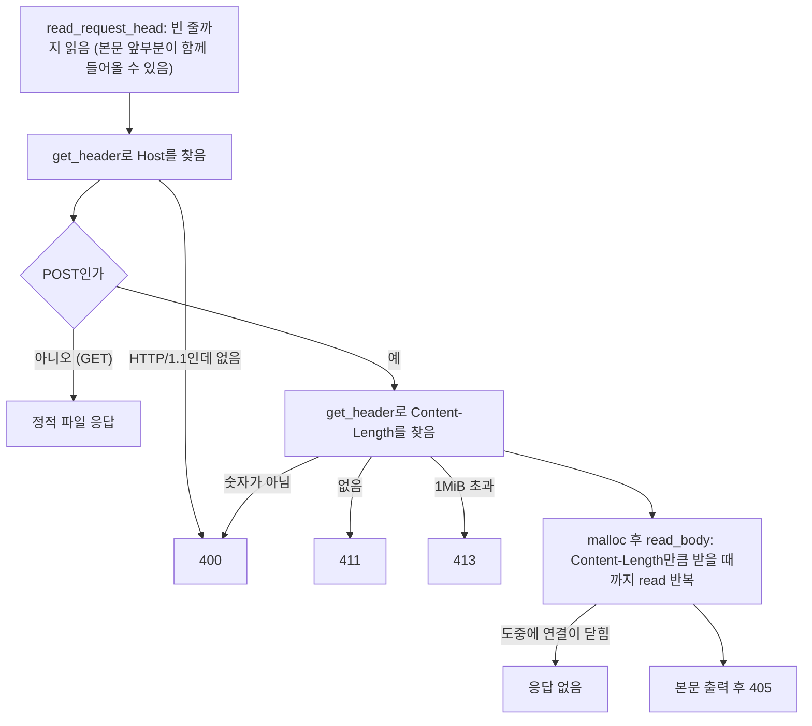

# 단계 6·7: 헤더 파싱과 POST 본문 (덩어리 2)

로드맵 단계 6(헤더 `Host`, `Content-Length`, `Connection` 파싱)과 단계 7(POST 본문 읽기, 411, 413)을 구현한 기록이다. 단계 4·5(`docs/step4-5.md`) 위에 쌓았다.

## 무엇을 만들었나

| 함수 (`src/http.c`) | 하는 일 |
|---|---|
| `get_header` | 요청 줄과 헤더 전체가 담긴 문자열에서 이름으로 헤더 값을 찾는다. 이름은 대소문자를 구분하지 않는다 |
| `parse_content_length` | `Content-Length` 값을 숫자로 바꾼다. 숫자가 아닌 글자가 있으면 실패 |
| `read_body` | 본문을 `Content-Length`바이트만큼 채운다. 헤더와 함께 이미 들어온 부분을 먼저 복사하고, 모자란 만큼 `read`를 반복한다 |

`src/handler.c`의 `respond`가 이 함수들을 쓴다. POST 요청이면 `receive_body`가 본문을 `malloc`한 메모리에 받아 서버 터미널에 출력한다. 정적 파일은 POST를 허용하지 않으므로 응답은 405다. 받은 본문을 실제로 쓰는 것은 단계 8(CGI)이다.

## 중요하다고 본 개념

**헤더와 본문의 경계.** 요청은 `요청 줄 CRLF 헤더 줄들 CRLF CRLF 본문` 순서다. 헤더의 끝은 빈 줄(`\r\n\r\n`)로 알 수 있지만, 본문에는 끝 표시가 없다. 본문의 길이는 `Content-Length` 헤더의 숫자로만 알 수 있다.

**`Content-Length`만큼 읽기.** TCP는 바이트 스트림이라 본문이 `read` 여러 번에 나뉘어 올 수 있고, 반대로 본문 앞부분이 헤더와 같은 `read`에 함께 들어올 수도 있다. 그래서 (1) 헤더 버퍼에서 빈 줄 뒤에 이미 들어온 바이트를 먼저 복사하고 (2) 받은 바이트 수가 `Content-Length`가 될 때까지 `read`를 반복한다.

**`malloc`과 `free`의 짝.** 본문 크기는 요청마다 달라서 `malloc(content_length + 1)`로 할당한다. `receive_body`가 성공하면 호출한 쪽(`respond`)이 `free`한다. 실패하는 모든 경로에서는 `receive_body` 안에서 `free`한다. `make asan`이 해제하지 않은 메모리를 잡아 준다.

**버퍼 오버플로 방지.** `Content-Length`가 1MiB를 넘으면 받기 전에 413으로 거절한다. 클라이언트가 보낸 숫자를 그대로 믿고 `malloc`하면 메모리를 원하는 만큼 쓰게 만들 수 있다. `read_body`는 `Content-Length`를 넘겨 읽지 않는다.

**`Host` 헤더.** HTTP/1.1 요청에는 반드시 있어야 한다. 한 IP 주소에서 여러 사이트를 서비스할 때 어느 사이트인지 알려 주는 값이다. 없으면 400이다.

**`Connection` 헤더.** `keep-alive`는 "응답 뒤에도 연결을 닫지 말고 다음 요청에 다시 쓰자", `close`는 "응답 뒤에 닫는다"는 뜻이다. HTTP/1.1은 헤더가 없으면 keep-alive가 기본이다. 이 서버는 값을 읽어 출력만 하고, 항상 `Connection: close`로 답한 뒤 닫는다.

## 결정사항과 이유

| 결정 | 선택 | 이유 |
|---|---|---|
| 헤더를 담는 방식 | 헤더 전체를 구조체로 미리 나누지 않고, 필요할 때 `get_header`로 이름을 찾음 | 쓰는 헤더가 세 개뿐이라 코드가 짧다. 찾을 때마다 처음부터 훑지만 헤더는 8KiB 이하다 |
| 본문 최대 크기 | 1MiB (`MAX_BODY_SIZE`) | 넘으면 413. 값은 임의로 정했고 근거가 되는 요구사항은 없다 |
| `Content-Length` 없는 POST | 411 | 길이를 모르면 본문을 읽을 수 없다. `Transfer-Encoding: chunked`는 지원하지 않는다 |
| POST에 405를 보내기 전 | 본문을 먼저 다 읽음 | 읽지 않은 데이터가 남은 채 닫으면 커널이 연결을 강제로 끊어(RST) 클라이언트가 응답을 못 받을 수 있다 |
| keep-alive | 구현하지 않음 (항상 close) | 아직 정하지 않은 항목이다. 로드맵의 "선택"에 있다 |

RFC 절 번호(RFC 9112 3.2절 Host, 5절 헤더 형식)는 기억에 의존해 적었고 원문은 대조하지 않았다. "읽지 않고 닫으면 RST"는 단계 1-3에서 측정한 사실이다.

## 확인한 것

| 확인 | 결과 |
|---|---|
| `make` | 경고 없음 |
| `make test` | PASS 171줄, 실패 0. 세 번 연속 실행해 모두 같음 |
| `make asan` | PASS 171줄, 메모리 오류 보고 없음 |
| `curl -d 'name=somang'` | 서버 터미널에 `본문 11바이트: name=somang` 출력, 응답 405 |
| 본문을 두 조각으로 나눠 보냄, 본문 100000바이트 | 서버가 받은 길이와 내용이 보낸 것과 같음 |

## 아직 하지 않은 것 (알고 있는 한계)

- 받은 본문을 쓰는 곳이 없다. 단계 8(CGI)에서 CGI 프로그램의 표준 입력으로 넘긴다.
- `Transfer-Encoding: chunked` 본문을 읽지 못한다(411).
- `Expect: 100-continue`에 답하지 않는다. curl은 큰 본문을 보낼 때 이 헤더를 붙이고 1초 기다린 뒤 본문을 보낸다.
- 본문을 서버 터미널에 그대로 출력한다. 글자가 아닌 바이트가 오면 터미널 출력이 깨질 수 있다.
- 본문을 보내다 멈춘 클라이언트가 있으면 `read`에서 계속 기다린다(타임아웃 없음).
