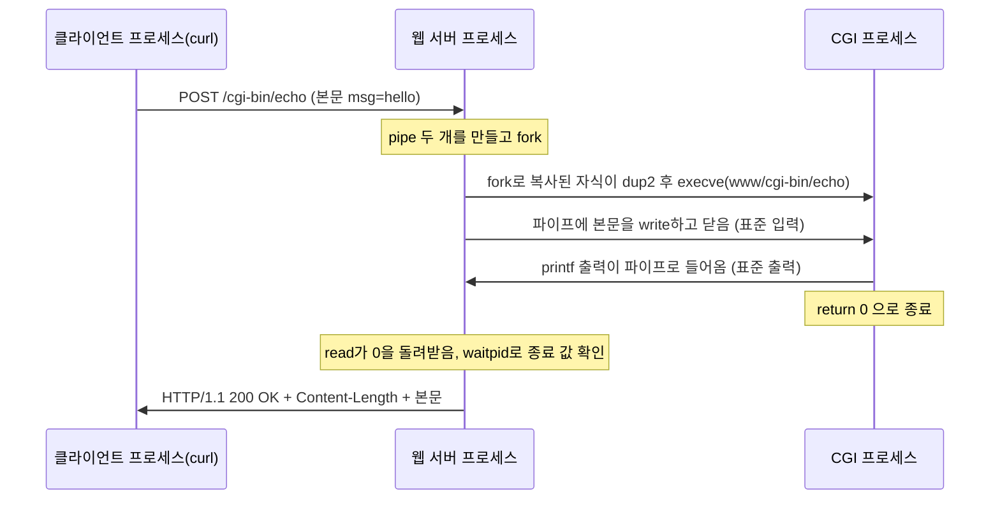

# 단계 8: CGI로 동적 요청 처리 (덩어리 3)

로드맵 단계 8을 구현한 기록이다. 단계 6·7(`docs/step6-7.md`) 위에 쌓았다.

## 무엇을 만들었나

요청 경로가 `/cgi-bin/`으로 시작하면, 웹 서버 프로세스는 그 파일을 보내는 대신 프로그램으로 실행하고 그 출력을 응답으로 보낸다. 정적 파일은 디스크의 내용을 그대로 보내지만, CGI는 요청이 올 때마다 프로그램이 응답을 새로 만든다.

| 파일 | 역할 |
|---|---|
| `src/cgi.c` | `run_cgi`: `pipe` → `fork` → 자식에서 `dup2`, `execve` → 부모에서 본문 쓰기, 출력 읽기, `waitpid`, 응답 보내기 |
| `src/handler.c` | 경로가 `/cgi-bin/`으로 시작하면 `run_cgi`를 부른다 |
| `src/main.c` | `signal(SIGPIPE, SIG_IGN)` 한 줄 추가 |
| `cgi/hello.c` | CGI 예제 1. 메서드, 쿼리 문자열, 프로세스 번호, 시각을 돌려준다 |
| `cgi/echo.c` | CGI 예제 2. POST 본문을 표준 입력에서 읽어 그대로 돌려준다 |
| `Makefile` | `make`가 `cgi/*.c`를 `www/cgi-bin/hello`, `www/cgi-bin/echo`로 빌드한다 |

CGI 예제 프로그램은 C로 작성했다(11/23 소망·준호 결정). 웹 서버와는 별도의 실행 파일이고 `src/`의 코드를 쓰지 않는다.

## 요청 정보를 넘기고 응답을 받는 방법

| 넘기는 것 | 방법 |
|---|---|
| 메서드 | 환경 변수 `REQUEST_METHOD` |
| 요청 대상의 `?` 뒤 | 환경 변수 `QUERY_STRING` |
| 본문 길이 | 환경 변수 `CONTENT_LENGTH` |
| POST 본문 | CGI 프로세스의 표준 입력 (파이프) |
| 응답 | CGI 프로세스의 표준 출력 (파이프). `헤더 줄, 빈 줄, 본문` 순서 |

## 중요하다고 본 개념

**`fork`.** 지금 프로세스를 복사해 자식 프로세스를 만든다. 열려 있는 fd도 함께 복사된다. `fork`는 두 프로세스에서 각각 돌아오는데, 자식에서는 0, 부모에서는 자식의 프로세스 번호를 돌려준다. 이 반환값으로 "지금 어느 쪽인지"를 구분한다.

**`execve`.** 지금 프로세스가 실행하는 프로그램을 다른 프로그램으로 바꾼다. 프로세스 번호와 열린 fd는 그대로 남는다. 성공하면 돌아오지 않는다. `fork`로 자식을 만든 뒤 자식에서 `execve`를 부르는 것이 "다른 프로그램을 실행하는" 유닉스의 기본 방법이다.

**`pipe`와 `dup2`.** `pipe`는 커널 안에 한 방향 통로를 만들고 fd 두 개(읽는 쪽, 쓰는 쪽)를 준다. `dup2(a, b)`는 fd `b`가 `a`와 같은 대상을 가리키게 만든다. 자식에서 표준 입력(0번)과 표준 출력(1번)을 파이프로 바꿔 두면, CGI 프로그램은 소켓을 몰라도 `stdin`에서 읽고 `printf`로 쓰기만 하면 된다.

**쓰지 않는 파이프 끝을 닫아야 하는 이유.** 파이프의 `read`는 쓰는 쪽 fd가 모두 닫혀야 0(끝)을 돌려준다. 부모가 `from_child[1]`을 닫지 않으면 자식이 끝나도 쓰는 쪽이 하나 남아서 부모의 `read`가 영원히 기다린다.

**`waitpid`와 좀비 프로세스.** 끝난 자식의 종료 기록은 부모가 `waitpid`로 거둘 때까지 커널에 남는다(좀비). `waitpid`는 종료 값도 알려 준다. 종료 값이 0이 아니면 CGI 프로그램이 실패한 것으로 보고 500을 보낸다.

**`SIGPIPE`.** 읽는 쪽이 닫힌 파이프나 소켓에 `write`하면 커널이 `SIGPIPE` 시그널을 보내고, 기본 동작은 프로세스 종료다. CGI 프로그램이 본문을 읽지 않고 끝나면 웹 서버 프로세스가 함께 끝날 수 있어서 `main`에서 무시하도록 했다.

## 결정사항과 이유

| 결정 | 선택 | 이유 |
|---|---|---|
| CGI 프로그램의 언어 | C | 11/23 소망·준호 결정 |
| CGI로 보는 경로 | `/cgi-bin/`으로 시작하는 경로 | 로드맵 단계 8. 실행 파일은 `<정적 파일 폴더>/cgi-bin/` 아래에 둔다 |
| CGI 출력 형식 | `헤더 줄, 빈 줄, 본문`. 헤더에서 `Content-Type`만 쓴다 | CGI의 표준 형식(RFC 3875)이다. 로드맵은 "표준 출력이 응답 본문"이라고만 적었는데, 프로그램이 `Content-Type`을 정할 수 있게 헤더를 받았다 |
| 응답 보내는 방식 | 출력을 끝까지 버퍼에 모은 뒤 `Content-Length`를 붙여 보냄 | 길이를 알아야 `Content-Length`를 쓸 수 있고, 프로그램이 실패하면 500으로 바꿔 보낼 수 있다. CSAPP의 Tiny는 자식의 표준 출력을 소켓에 직접 연결해 바로 보낸다 |
| 출력 최대 크기 | 1MiB, 넘으면 500 | 값은 임의로 정했다 |
| 환경 변수 | `execve`의 셋째 인자로 필요한 것만 직접 만들어 넘김 | 웹 서버 프로세스의 환경 변수(`PATH`, `HOME` 등)를 CGI 프로그램에 넘기지 않는다 |
| `SIGPIPE` 무시 | 이 단계에 넣음 | 로드맵 단계 10의 항목이지만, 없으면 CGI가 먼저 끝날 때 서버가 죽는다 |

RFC 3875 인용은 기억에 의존했고 원문은 대조하지 않았다. CSAPP Tiny와의 비교는 책의 `serve_dynamic` 코드에 대한 기억이다.

## 확인한 것

| 확인 | 결과 |
|---|---|
| `make` | 경고 없음 |
| `make test` | PASS 199줄, 실패 0. 세 번 연속 실행해 모두 같음 |
| `make asan` | PASS 199줄, 메모리 오류 보고 없음 |
| `curl 'http://localhost:8080/cgi-bin/hello?name=somang'` | 본문에 `QUERY_STRING=name=somang`, 호출마다 pid가 달라짐 |
| `curl -d 'msg=hello' http://localhost:8080/cgi-bin/echo` | 본문에 `CONTENT_LENGTH=9`, `msg=hello` |
| 없는 프로그램 / 실행 권한 없음 / 0이 아닌 종료 / 빈 줄 없는 출력 | 404 / 403 / 500 / 500 |
| CGI 호출 뒤 서버의 자식 프로세스 | 남아 있지 않음(`pgrep -P`), 연결 fd 번호도 그대로(파이프 fd를 모두 닫음) |

## 아직 하지 않은 것 (알고 있는 한계)

- CGI 프로그램이 끝나지 않으면 웹 서버 프로세스도 `read`에서 계속 기다린다(타임아웃 없음). 한 번에 연결 하나만 처리하므로 그동안 다른 요청을 받지 못한다.
- 본문을 다 쓴 뒤에 출력을 읽는다. CGI 프로그램이 본문을 읽기 전에 64KiB(파이프 버퍼 크기)보다 많이 출력하고, 본문도 64KiB보다 크면 양쪽이 서로 기다리며 멈춘다. `cgi/echo.c`는 본문을 먼저 다 읽으므로 해당하지 않는다.
- CGI 출력의 `Status` 헤더를 쓰지 않는다. 성공하면 항상 200이다.
- `CONTENT_TYPE`, `SCRIPT_NAME`, `PATH_INFO` 같은 다른 CGI 환경 변수는 넘기지 않는다.
- 자식 프로세스가 듣기 소켓 fd를 물려받는다(닫지 않았다).
- `/cgi-bin/` 아래의 실행 권한 있는 파일은 무엇이든 실행한다.
