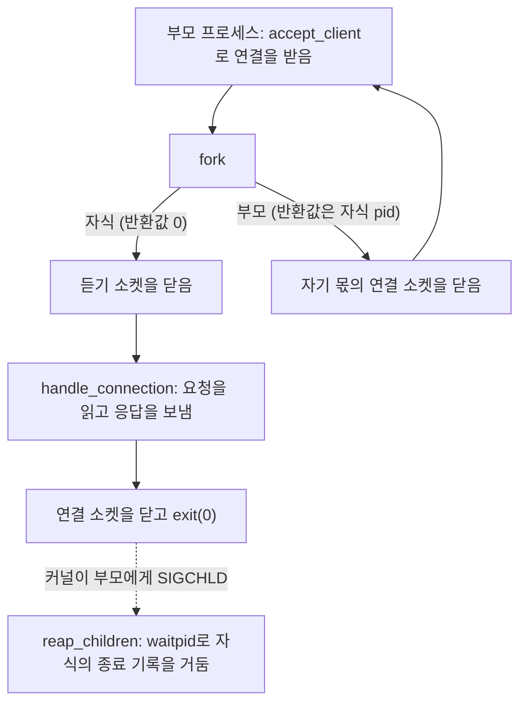

# 단계 9·10: 동시 연결 처리와 안전 종료 (덩어리 4)

로드맵 단계 D(동시성 모델 결정), 9(동시 연결 처리), 10(시그널과 안전 종료)을 구현한 기록이다. 단계 8(`docs/step8.md`) 위에 쌓았다.

## 결정: 연결마다 fork (process-per-connection)

11/23 소망이 "연결마다 fork"를 골랐다. 후보는 연결마다 fork, 연결마다 스레드, 스레드 풀, `poll`/`epoll` 이벤트 루프였다.

| 모델 | 장점 | 단점 |
|---|---|---|
| 연결마다 fork (선택) | `main.c`의 반복문만 바꾸면 된다. 단계 8에서 쓴 `fork`, `waitpid`로 설명할 수 있다. 자식 하나가 죽어도 서버는 산다. 프로세스끼리 메모리를 공유하지 않아 잠금이 필요 없다 | 연결마다 프로세스를 만드는 비용이 크다. 연결이 매우 많으면(C10K) 프로세스 수가 감당되지 않는다 |
| 연결마다 스레드 | 프로세스보다 만드는 비용이 작다 | 메모리를 공유하므로 공유 변수에 잠금이 필요하다. 스레드 하나의 잘못된 메모리 접근이 서버 전체를 끝낸다 |
| 스레드 풀 | 스레드 수가 고정되어 연결이 몰려도 자원 사용이 일정하다 | 큐, 뮤텍스, 조건 변수가 필요하다 |
| 이벤트 루프 | 스레드 하나로 많은 연결을 다룬다 | 논블로킹으로 바꾸고 연결마다 진행 상태를 저장해야 해서 읽기 코드를 다시 써야 한다 |

## 무엇을 만들었나

| 바뀐 곳 | 내용 |
|---|---|
| `src/main.c` 반복문 | `accept` 뒤에 `fork`. 자식이 `handle_connection`을 하고 `exit(0)`, 부모는 `conn_fd`를 닫고 다음 `accept`로 |
| `src/main.c` `reap_children` | `SIGCHLD` 핸들러. `waitpid(-1, NULL, WNOHANG)`을 반복해 끝난 자식을 모두 거둔다 |
| `src/main.c` `on_stop_signal`, `stop_requested` | `SIGINT`, `SIGTERM` 핸들러. 변수만 1로 바꾼다. 반복문이 이 변수를 보고 끝난다 |
| `src/main.c` 반복문 뒤 | 듣기 소켓을 닫고, 처리 중인 자식이 모두 끝날 때까지 `waitpid`로 기다린 뒤 `return 0` |
| `src/net.c` `write_all` | 요청한 바이트를 다 쓸 때까지 `write`를 반복한다. `send_file`, `send_error`, `run_cgi`가 쓴다 |
| `src/net.c` `accept_client` | `accept`가 시그널로 중단된 경우(`EINTR`)에는 에러 문구를 출력하지 않는다 |

## 중요하다고 본 개념

**부모와 자식이 fd를 나눠 닫는 이유.** `fork`는 열린 fd를 복사한다. 부모와 자식의 `conn_fd`는 같은 연결을 가리키고, 커널은 그 연결을 가리키는 fd가 모두 닫혀야 연결을 끝낸다. 부모가 `conn_fd`를 닫지 않으면 자식이 응답을 다 보내고 끝나도 클라이언트는 연결이 끝난 것을 모르고, 부모의 fd도 연결마다 하나씩 샌다. 자식은 새 연결을 받지 않으므로 듣기 소켓을 닫는다.

**좀비 프로세스와 `SIGCHLD`.** 끝난 자식의 종료 기록은 부모가 `waitpid`로 거둘 때까지 커널에 남는다. 부모는 `accept`에서 기다리는 중이라 자식을 기다려 줄 수 없다. 자식이 끝나면 커널이 부모에게 `SIGCHLD`를 보내므로, 그 핸들러에서 `waitpid(-1, NULL, WNOHANG)`으로 거둔다. `WNOHANG`은 끝난 자식이 없으면 기다리지 않고 바로 돌아오라는 뜻이다. 시그널 한 번에 자식 여러 개가 끝나 있을 수 있어서 반복한다.

**시그널 핸들러에서 할 수 있는 일.** 핸들러는 프로그램이 무엇을 하던 중이든 끼어들어 실행된다. `printf`나 `malloc` 도중에 끼어들어 같은 함수를 또 부르면 내부 상태가 깨진다. 그래서 핸들러는 변수 하나(`volatile sig_atomic_t`)만 바꾸고, 실제 정리는 `main`의 반복문이 한다.

**안전 종료.** `SIGINT`(Ctrl+C), `SIGTERM`(`kill`)의 기본 동작은 그 자리에서 프로세스 종료다. 핸들러를 등록하면 종료 대신 `stop_requested`가 1이 되고, 기다리던 `accept`가 -1(`EINTR`)로 돌아와 반복문이 끝난다. 그 뒤 듣기 소켓을 닫고(새 연결 거절), 처리 중인 자식이 끝나기를 기다린다. 정상 종료이므로 `make asan`의 누수 검사가 종료 시점에 실행된다.

**blocking과 non-blocking.** 이 서버의 `accept`, `read`, `write`는 모두 blocking이다. 할 일이 없으면 커널이 프로세스를 재우고, 일이 생기면 깨운다. 프로세스 하나가 연결 하나에서 멈춰 있어도 다른 연결은 다른 프로세스가 처리하므로 문제가 없다. 이벤트 루프 모델은 프로세스 하나가 여러 연결을 다루므로, 멈추지 않는 non-blocking 호출과 `poll`/`epoll`이 필요하다.

**`write_all`이 다시 필요해진 이유.** 단계 3에서 "블로킹 소켓의 `write`는 요청한 바이트를 모두 쓰고 돌아온다. 일부만 쓰는 것은 쓰는 도중 핸들러가 있는 시그널이 왔을 때다"를 측정했고, 그때는 핸들러가 없어서 `write_all`을 뺐다. 이제 `SIGINT`, `SIGTERM`, `SIGCHLD`에 핸들러를 등록했으므로 그 경우가 실제로 생길 수 있다.

## 결정사항과 이유

| 결정 | 선택 | 이유 |
|---|---|---|
| 좀비 회수 | `SIGCHLD` 핸들러 + `waitpid(WNOHANG)` 반복 | 부모가 `accept`에서 기다리는 중에도 바로 거둔다 |
| `SIGCHLD`의 `sa_flags` | `SA_RESTART` | 자식이 끝날 때마다 `accept`가 중단될 필요가 없다 |
| `SIGINT`/`SIGTERM`의 `sa_flags` | 0 (`SA_RESTART` 없음) | `accept`가 `EINTR`로 돌아와야 연결이 없어도 반복문이 종료 요청을 확인한다 |
| 자식에서 `SIGCHLD` | 기본 동작으로 되돌림 | `run_cgi`가 `waitpid`로 CGI 프로세스의 종료 값을 직접 받아야 한다 |
| 종료 요청이 두 번 오면 | 핸들러에서 `_exit(1)` | 아무것도 보내지 않는 클라이언트를 기다리느라 끝나지 못할 때 강제로 끝낼 방법이다 |
| 자식의 종료 | `exit(0)` | 정상 종료라서 `make asan`이 자식의 누수도 검사한다 |
| 동시에 만들 자식 수 | 제한 없음 | 단순하게 두었다. 한계에 적었다 |

## 확인한 것

| 확인 | 결과 |
|---|---|
| `make` | 경고 없음 |
| `make test` | PASS 212줄, 실패 0. 다섯 번 연속 실행해 모두 같음 |
| `make asan` | PASS 212줄, 메모리 오류·누수 보고 없음 (부모와 자식 모두 정상 종료) |
| 멈춰 있는 연결 A가 있는 동안 연결 B | B가 3초 안에 200을 받음. 그 뒤 A도 200 |
| 동시에 보낸 요청 30개 | 모두 200 |
| 자식 프로세스 | 요청을 모두 처리한 뒤 남아 있지 않음 (`pgrep -P`) |
| 8MiB 응답 도중 클라이언트가 끊음 | 서버가 계속 실행되고 다음 요청에 200 |
| `SIGTERM` | 처리 중인 연결을 끝까지 응답한 뒤 종료 코드 0 |
| `SIGINT` | 종료 코드 0 |

부하 테스트 도구(`ab`, `wrk`, `hey`)는 컨테이너에 없어서 실행하지 못했다.

## 아직 하지 않은 것 (알고 있는 한계)

- 자식 프로세스 수에 상한이 없다. 연결이 한꺼번에 몰리면 프로세스가 그만큼 생긴다.
- `read` 타임아웃이 없다. 아무것도 보내지 않는 연결은 자식 프로세스 하나를 계속 차지한다.
- 여러 자식의 출력이 서버 터미널에 섞여 나온다. 어느 연결의 줄인지 구분하는 표시가 없다.
- 종료 요청이 "반복문의 조건 확인"과 "`accept` 진입" 사이의 짧은 순간에 오면, 다음 연결이 올 때까지 종료가 늦어진다.
- `kill`로 부모에게만 `SIGTERM`을 보내면, 멈춰 있는 클라이언트를 맡은 자식이 끝날 때까지 부모가 기다린다. 한 번 더 보내면 부모는 바로 끝난다.
- keep-alive는 없다. 응답마다 연결을 닫는다.
