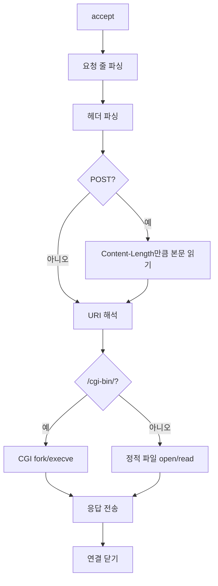

# 웹 서버 구현

CS:APP 11장 Tiny를 바탕으로 만든 HTTP/1.0 웹 서버. TCP 소켓으로 연결을 받고, HTTP 요청을 파싱해 정적 파일이나 CGI 응답을 보낸다.

## 구현 범위

| 과제 항목 | 상태 | 구현 |
|---|---|---|
| TCP 소켓 서버 | 완료 | `Open_listenfd`(`socket`→`bind`→`listen`) + `accept` 루프 |
| HTTP 요청 파싱 | 완료 | 요청 줄(method·URI·version), 헤더, `Content-Length` 본문 |
| HTTP 응답 생성 | 완료 | 상태 줄, `Server`, `Connection`, `Content-Type`, `Content-Length` |
| 정적 파일 서빙 | 완료 | `www/` 기준, MIME 매핑, 404·403·500 |
| 동적 요청 처리 | 완료 | `/cgi-bin/` CGI(`fork`+`execve`), GET·HEAD·POST |
| 동시 요청 처리 | **미구현** | 한 연결씩 순차 처리. thread 또는 poll 방식을 추가해야 함 |

## 파일 구조

| 파일 | 역할 |
|---|---|
| `src/server_main.c` | `main`, accept 루프, SIGCHLD·SIGPIPE 처리 |
| `src/http.c`, `include/http.h` | 요청 줄·헤더·본문 파싱, 오류 응답 |
| `src/serve.c`, `include/serve.h` | URI 해석, 정적 파일, CGI |
| `src/netlib.c`, `include/netlib.h` | Rio(`rio_readn`·`rio_readnb`·`rio_readlineb`·`rio_writen`), `Open_listenfd`, 책 스타일 래퍼 |
| `www/` | 문서 루트. HTML·GIF·MPG·폼과 `cgi-bin/adder`·`postecho` |
| `tests/server_test.sh` | 통합 테스트 |

## 요청 처리 흐름



- 요청 줄은 조각 3개(method, target, version)만 받는다. 그 외는 400.
- 헤더는 빈 줄까지 읽고 `Content-Length`·`Content-Type`·`Transfer-Encoding`만 저장한다. 중복 `Content-Length`는 400, `Transfer-Encoding`은 501.
- POST 본문은 `rio_readnb`로 정확히 `Content-Length`만큼 읽는다(연결 버퍼에 남은 바이트 포함). 1MB를 넘으면 413.
- `/cgi-bin/`만 동적으로 처리한다. 실행 권한이 없으면 403.
- CGI는 `fork`+`execve`로 실행한다. POST 본문은 `tmpfile()`에 써서 자식 stdin으로 `dup2`한다.
- CGI 자식은 `SIGCHLD` 핸들러가 `waitpid(-1, NULL, WNOHANG)`로 회수한다(`SA_RESTART | SA_NOCLDSTOP`). 커널 재시작을 타지 않는 `EINTR`에 대비해 `accept`와 HEAD 파이프 읽기(`read_all`)도 직접 재시도한다.
- `SIGPIPE`는 무시하고, 소켓 쓰기는 `rio_writen` 반환값을 확인해 실패한 연결만 포기한다.
- 헤더가 빈 줄로 끝나지 않고 EOF가 오면 400으로 끝낸다.

## 지원 메서드와 상태 코드

| 메서드 | 처리 |
|---|---|
| `GET` | 정적 파일 또는 CGI |
| `HEAD` | GET과 같은 헤더, 본문 생략. CGI는 출력을 파이프로 받아 헤더만 전송 |
| `POST` | `/cgi-bin/`만 허용. 정적 경로는 405 |
| 그 외 | 501 |

| 코드 | 상황 |
|---|---|
| 400 | 요청 줄·헤더 형식 오류, 중복 `Content-Length`, POST에 `Content-Length` 없음, 짧은 본문 |
| 403 | 문서 루트 밖 경로(`..`), 읽기/실행 권한 없음 |
| 404 | 파일 없음 |
| 405 | 정적 경로에 POST |
| 413 | 본문 1MB 초과 |
| 414 | 요청 줄 또는 URI 2KB 초과 |
| 431 | 헤더 8KB 또는 100줄 초과 |
| 500 | 파일 열기·읽기 실패, CGI 헤더 없음 |
| 501 | 지원하지 않는 메서드, `Transfer-Encoding` |
| 505 | HTTP/1.0·1.1 외 버전 |

## 정적 파일

- `www/`를 문서 루트로 보고 `www/`에서 서버를 실행한다. `/`는 `home.html`을 찾는다.
- MIME: `.html`, `.css`, `.js`, `.gif`, `.png`, `.jpg`/`.jpeg`, `.mpg`/`.mpeg`, 그 외 `text/plain`.
- 파일 전체를 `malloc`해 `rio_readn`으로 읽고 `rio_writen`으로 보낸다. 0바이트 파일은 헤더만 보낸다.

## 테스트

```
make test
```

`tests/server_test.sh`가 `www/`에서 서버를 띄우고 확인한다.

- 정적 본문·MIME·0바이트·100KB 파일
- CGI adder(GET 폼과 `1&2`), POST 본문 에코
- HEAD(정적·CGI·404), 400·403·404·405·413·414·431·501·505
- CGI 좀비 없음(SIGCHLD), 조기 종료 뒤 서버 생존(SIGPIPE/EPIPE)

## 한계

- **동시 요청 처리 없음**: `accept` 후 `doit`이 끝날 때까지 다음 연결을 받지 않는다. 느린 클라이언트 하나가 다른 요청을 막는다. 과제 필수 항목이라 thread-per-connection 또는 poll 기반으로 추가해야 한다.
- HTTP/1.0 고정, keep-alive 없음. 응답 후 연결을 닫는다.
- Reverse Proxy 없음. 동적 요청은 CGI로만 처리한다.
- 퍼센트 인코딩(`%2e%2e`)과 심볼릭 링크를 통한 문서 루트 탈출은 막지 않는다.
- TLS, 압축, 디렉터리 목록, 가상 호스트는 범위 밖이다.
